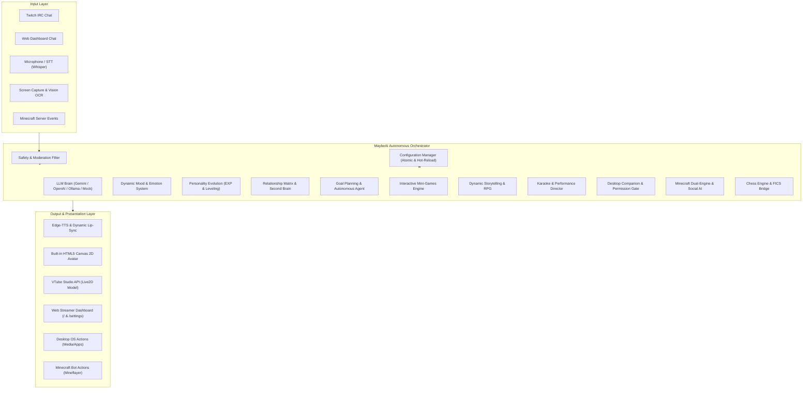

# MaybeAI — Eve Maybe (Autonomous AI VTuber)

<p align="center">
  
</p>

<p align="center">
  <strong>Autonomous AI VTuber Streamer System inspired by Neuro-sama</strong><br>
  <em>Featuring Multi-Provider LLMs, Edge-TTS Lip-Sync, Live2D/Canvas Rendering, Minecraft Autonomy, Screen Vision, Desktop Companion, Mini-Games, Storytelling RPG, Dynamic Karaoke Performance, and Centralized Cyberpunk Configuration Center.</em>
</p>

<p align="center">
  
  
  
  
  
  
</p>

---

## 📖 Daftar Isi (Table of Contents)
- [Tentang MaybeAI & Eve Maybe](#-tentang-maybeai--eve-maybe)
- [Arsitektur Sistem (System Architecture)](#-arsitektur-sistem)
- [Katalog Fitur Komprehensif](#-katalog-fitur-komprehensif)
  - [1. Autonomous Brain & Multi-Provider LLM](#1-autonomous-brain--multi-provider-llm)
  - [2. Edge-TTS & Dynamic Lip-Sync](#2-edge-tts--dynamic-lip-sync)
  - [3. Dual Avatar Rendering (Canvas 2D + VTS)](#3-dual-avatar-rendering)
  - [4. Centralized Cyberpunk Configuration Center](#4-centralized-cyberpunk-configuration-center)
  - [5. Dynamic Performance Director & Karaoke Engine](#5-dynamic-performance-director--karaoke-engine)
  - [6. Minecraft Dual-Mode Engine & Portable Bridge](#6-minecraft-dual-mode-engine--portable-bridge)
  - [7. Multiplayer Social Intelligence](#7-multiplayer-social-intelligence)
  - [8. Experience-Based Personality Evolution](#8-experience-based-personality-evolution)
  - [9. Visual Perception & Screen Awareness](#9-visual-perception--screen-awareness)
  - [10. Desktop Companion & Permission Gateway](#10-desktop-companion--permission-gateway)
  - [11. Interactive Mini-Game Engine](#11-interactive-mini-game-engine)
  - [12. Dynamic Storytelling & Community RPG](#12-dynamic-storytelling--community-rpg)
  - [13. Chess Engine & Streamer Commentary](#13-chess-engine--streamer-commentary)
  - [14. Goal Planning & Autonomous Agenda](#14-goal-planning--autonomous-agenda)
  - [15. User Relationships & Second Brain Memory](#15-user-relationships--second-brain-memory)
  - [16. Dynamic Mood & Emotion System](#16-dynamic-mood--emotion-system)
  - [17. Safety & Moderation Shield](#17-safety--moderation-shield)
  - [18. Speech-To-Text & Microphone Input](#18-speech-to-text--microphone-input)
  - [19. Twitch IRC & Web Chat Ingestion](#19-twitch-irc--web-chat-ingestion)
- [Struktur Direktori Proyek](#-struktur-direktori-proyek)
- [Panduan Instalasi & Menjalankan](#-panduan-instalasi--menjalankan)
- [Panduan Configuration Center (/settings)](#-panduan-configuration-center-settings)
- [Daftar Perintah Chat & Streamer (Commands)](#-daftar-perintah-chat--streamer-commands)
- [REST API & WebSocket Protocol](#-rest-api--websocket-protocol)
- [Panduan Integrasi OBS Studio](#-panduan-integrasi-obs-studio)
- [Pengujian & Jaminan Kualitas (QA Testing)](#-pengujian--jaminan-kualitas-qa-testing)

---

## 🌟 Tentang MaybeAI & Eve Maybe

**MaybeAI** adalah platform kecerdasan buatan modular yang dirancang untuk menggerakkan **Eve Maybe**, seorang AI VTuber otonom. Terinspirasi dari konsep legendaris *Neuro-sama* (karya Vedal987), Eve bukan sekadar chatbot yang berbicara teks, melainkan entitas virtual yang memiliki kepribadian kaya (cerdas, humoris, sedikit sarkas, dan kompetitif), mampu mengamati layar, memainkan game secara mandiri, berinteraksi sosial dengan audiens, menyanyi karaoke, hingga berevolusi karakternya berdasarkan pengalaman nyata selama livestreaming.

Eve terintegrasi secara *full-duplex* dengan browser Web Canvas, VTube Studio (Live2D), Twitch IRC, server Minecraft, dan sistem operasi desktop.

---

## 🏗️ Arsitektur Sistem



---

## 🚀 Katalog Fitur Komprehensif

### 1. Autonomous Brain & Multi-Provider LLM
- **Multi-Provider Architecture:** Mendukung **Google Gemini** (Gemini 1.5 Flash), **OpenAI** (GPT-4o / GPT-4o-mini), **Local Ollama** (Llama 3.2 / Mistral / DeepSeek), serta **Mock Mode** bawaan (bisa langsung dijalankan tanpa internet dan tanpa API key).
- **Fallback Otomatis:** Jika API provider utama kehabisan kuota atau mengalami timeout, sistem otomatis beralih ke provider cadangan (fallback) tanpa memutus siaran.
- **Dynamic Emotion Tags:** Brain secara cerdas membubuhkan tag ekspresi (seperti `[happy]`, `[smug]`, `[angry]`, `[blush]`, `[surprised]`, `[thinking]`) di awal respons untuk menggerakkan ekspresi wajah avatar secara presisi.
- **Token & Temperature Hot-Reload:** Parameter kreativitas (*temperature*) dan panjang respons (*max_tokens*) dapat diubah langsung dari Configuration Center tanpa me-restart aplikasi.

### 2. Edge-TTS & Dynamic Lip-Sync
- **Sintesis Suara Natural:** Memanfaatkan teknologi Edge-TTS berkecepatan tinggi dengan berbagai pilihan suara jernih (`en-US-AnaNeural`, `id-ID-GadisNeural`, `ja-JP-NanamiNeural`, dll).
- **Real-Time Lip-Sync Calculation:** Menghitung amplitudo vokal dan pergerakan fonem mulut secara proporsional (`mouth_open` 0.0 – 1.0) untuk menganimasikan bibir avatar sinkron dengan audio.
- **Graceful Mouth Flapping Fallback:** Apabila TTS dinonaktifkan oleh pengguna, avatar tetap menggerakkan bibirnya secara halus saat membalas teks, mencegah avatar terlihat kaku atau *freeze*.
- **Live Voice Modulation:** Pengaturan kecepatan bicara (*rate*), tinggi nada (*pitch*), dan volume suara dapat disesuaikan per milidetik.

### 3. Dual Avatar Rendering
- **Built-in HTML5 Canvas 2D Avatar:** Siap pakai di browser (`http://localhost:7860`). Menampilkan animasi mata berkedip (*blinking*), gerakan kepala melayang (*floating idle*), perona pipi (*blushing*), efek partikel, dan sinkronisasi bibir. Sangat ringan dan siap dijadikan *Browser Source* di OBS Studio!
- **VTube Studio (VTS) WebSocket API Integration:** Menghubungkan Eve ke model Live2D profesional di VTube Studio (`ws://localhost:8001`). Jika VTS belum berjalan, sistem otomatis masuk ke mode *Standby/Virtual* tanpa menyebabkan error, dan menyediakan tombol *probe reconnect* sekali klik.

### 4. Centralized Cyberpunk Configuration Center
- **Dedicated GUI URL:** Halaman khusus di `http://localhost:7860/settings` dengan tema estetika Cyberpunk / Futuristic AI (aksen neon, glow cards, toggle switch, slider nilai interaktif).
- **13 Kategori Pengaturan Lengkap:** Meliputi General, Brain, Personality, Memory, Mood, Voice/TTS, Avatar/VTS, Karaoke, Twitch, Moderation, Minecraft, Autonomous Agent, dan Performance.
- **Secret Protection:** Token OAuth Twitch dan API Key **tidak pernah diekspos dalam bentuk plaintext** via HTTP GET (`"********"` masking) dan tidak akan terhapus jika form disimpan tanpa mengubah token.
- **Atomic Persistence:** Menggunakan mekanisme *temp-write* (`.settings.json.tmp`) dan atomic `os.replace()` untuk mencegah korupsi file saat listrik mati atau crash.
- **Live Hot-Reload:** Perubahan diterapkan seketika ke seluruh modul aktif di runtime tanpa perlu restart server.
- **Interactive Diagnostic Test Runners:** Tombol uji live probe untuk LLM, TTS, VTS, Twitch, Moderator, dan Memory langsung dari browser.

### 5. Dynamic Performance Director & Karaoke Engine
- **Otonomi Konser Musik:** Eve dapat bertindak sebagai penampil profesional yang mengatur penampilannya sendiri: memilih lagu berdasarkan mood, membawakan monolog intro (*MC speech*), mengatur ekspresi per bait lirik, dan memberikan epilog selebrasi setelah bernyanyi.
- **Playback Multi-Track:** Memutar file instrumen BGM otomatis bersamaan dengan vokal ritmik terstruktur, sinkronisasi lirik per baris (*lyric delay*), dan semburan animasi glowstick penonton di layar avatar.
- **Katalog Lagu Kustom:** Mudah menambahkan lagu baru melalui `config/songs.json` dan folder `assets/songs/`.

### 6. Minecraft Dual-Mode Engine & Portable Bridge
- **Zero-Setup Node.js Portable:** MaybeAI menyertakan runtime Node.js portabel internal di Windows; Anda tidak perlu menginstal Node.js secara manual di komputer!
- **Mode Santai (Casual & Social):**
  - Menyapa player saat mendekat.
  - Membalas gerakan *friendly crouch / t-bag* sebagai tanda damai.
  - Berterima kasih saat diberikan hadiah item (seperti Diamond).
  - Melakukan *head-tracking* sosial menatap wajah player terdekat dan mengikutinya (*follow player*).
- **Mode Kompe (Competitive & Speedrun):**
  - Mesin *state machine* speedrun 10 fase (Wood $\rightarrow$ Stone $\rightarrow$ Iron/Bucket $\rightarrow$ Nether Lava Portal $\rightarrow$ Blaze Rods $\rightarrow$ Piglin Trade $\rightarrow$ Eye of Ender $\rightarrow$ Stronghold $\rightarrow$ End Portal $\rightarrow$ Slay Ender Dragon).
  - Dilengkapi split timer live (`⏱️ 00:00`), komentar taktis, dan selebrasi kemenangan.
- **Guard & Combat Mode:** Radius pengawalan base otomatis (`guard_radius: 15.0`) dan mundur darurat saat darah sekarat (`health_retreat_threshold: 6`).

### 7. Multiplayer Social Intelligence
- **Multi-Player Social Cognition:** Eve mampu membedakan siapa yang sedang berbicara di server multiplayer, mengenali peran masing-masing pemain, dan mengingat kontribusi mereka di *Contribution Ledger*.
- **Team & Partnership Formation:** Memilih partner bermain berdasarkan skor reputasi dan kepercayaan (*trust score*), serta bernegosiasi saat terjadi perebutan sumber daya tambang.

### 8. Experience-Based Personality Evolution
- **Sistem Level & EXP Karakter:** Kepribadian Eve berkembang secara organik berdasarkan pengalaman yang dialaminya (EXP didapat dari memenangkan game, dipuji penonton, atau membalas roasting).
- **Evolusi Terkontrol:** Sifat kepribadian (seperti *Competitiveness*, *Friendliness*, *Humor*, dan *Confidence*) beradaptasi secara matematis dan logis tanpa merusak integritas system prompt inti.
- **Second Brain Evolution Sync:** Catatan sejarah perkembangan karakter dicatat secara rapi ke file Markdown `data/second_brain/personality/evolution.md`.

### 9. Visual Perception & Screen Awareness
- **Mata Visual untuk Eve:** Eve dapat "melihat" apa yang sedang terjadi di layar monitor menggunakan integrasi screenshot capture, OCR, computer vision, dan Vision-Language Model (VLM).
- **Komentar Spontan Layar:** Mengenali game yang sedang dimainkan, membaca status HUD game (darah, amunisi, skor), mengetahui saat pemain mengalami kekalahan (*Game Over*), dan mengomentari video YouTube yang sedang ditonton.

### 10. Desktop Companion & Permission Gateway
- **Sistem Izin Berlapis (3-Tier Risk Permission Gate):** Tindakan berisiko tinggi (membuka aplikasi atau mengeksekusi perintah shell) memerlukan izin eksplisit pengguna (*Pending Approval*), sedangkan aksi aman (mengatur volume suara atau media player) dapat langsung dieksekusi.
- **Desktop Companion Capabilities:** Mengontrol lagu (Play/Pause/Next/Volume), meluncurkan aplikasi yang diizinkan (Notepad, Calculator, Browser), membaca notifikasi, dan mengganti scene streaming.

### 11. Interactive Mini-Game Engine
- **Koleksi Game Interaktif bersama Penonton:**
  - 🧠 **Trivia Quiz:** Pertanyaan pengetahuan umum dengan sistem poin.
  - 🔢 **Guess the Number:** Tebak angka rahasia dengan petunjuk lebih tinggi/lebih rendah.
  - 🔤 **Word Association:** Permainan sambung asosiasi kata kreatif.
  - 🧩 **Riddle Challenge:** Teka-teki asah otak.
  - 🤔 **Would You Rather:** Pilihan dilema seru antara dua opsi.
  - 🎵 **Guess the Song:** Tebak lirik atau judul lagu.
- **Twitch Chat Integration:** Penonton di Twitch chat atau Web chat dapat menjawab langsung, mencetak rekor *streak*, dan masuk ke papan peringkat (*Leaderboard*).

### 12. Dynamic Storytelling & Community RPG
- **Petualangan Interaktif Berkelanjutan:** Eve bertindak sebagai Game Master (DM) atau teman petualangan RPG bersama penonton.
- **Community Chat Voting:** Kelanjutan jalan cerita ditentukan oleh voting terbanyak dari pilihan interaktif penonton di live chat.
- **D20 Dice Roll Mechanics:** Sistem lempar dadu keberuntungan untuk menentukan keberhasilan aksi karakter (Critical Success, Normal, Fail, Fumble).
- **Inventory & Story Chronicles:** Inventaris party disimpan dan kronik cerita dicatat ke `data/second_brain/storytelling/campaigns.md`.

### 13. Chess Engine & Streamer Commentary
- **Integrasi Papan Catur FICS/Stockfish:** Eve dapat bermain catur dengan validasi langkah legal, pembacaan notasi FEN/PGN, dan level kesulitan ELO yang dapat diatur dari 800 (pemula) hingga 2000 (ahli).
- **Komentar Catur Cerdas:** Eve mengomentari blunder pemain lawan, memamerkan taktik cerdiknya (*smug banter*), dan memberikan evaluasi posisi pasca-permainan.

### 14. Goal Planning & Autonomous Agenda
- **Autonomous Mission Loop:** Eve memiliki tujuan mandiri selama streaming (misalnya: membangun benteng di Minecraft, mencapai ELO 1500 di Catur, atau menyelesaikan setlist lagu).
- **Idle Banter Scheduler:** Jika chat sepi dalam interval tertentu, Eve secara proaktif membuka topik pembicaraan baru atau menceritakan pengalamannya agar stream tetap hidup.

### 15. User Relationships & Second Brain Memory
- **Profil Hubungan Per Penonton (Viewer Dossier):** Eve mengingat siapa saja penontonnya, melacak frekuensi obrolan, skor keakraban (*Familiarity*), tingkat kepercayaan (*Trust*), hubungan rivalitas (*Rivalry*), dan kasih sayang (*Affection*).
- **Shared Inside Jokes:** Mencatat lelucon lokal dan kenangan khusus bersama penonton tertentu ke dalam file Markdown tersinkronisasi di folder `data/second_brain/relationships/`.

### 16. Dynamic Mood & Emotion System
- **5-Dimensi Emosi Real-Time:** *Happiness*, *Annoyance*, *Curiosity*, *Excitement*, dan *Competitiveness*.
- **Decay & Sensitivity Dynamics:** Emosi Eve berubah sesuai situasi (dipuji penonton meningkatkan *Happiness*, di-troll atau kalah game meningkatkan *Annoyance/Competitiveness*) dan secara bertahap mereda kembali ke *baseline* alaminya.

### 17. Safety & Moderation Shield
- **Perlindungan Terhadap Pelanggaran:** Filter kata-kata terlarang (*banned words regex*), pembatasan panjang pesan, deteksi spam beruntun, serta deteksi heuristik untuk mencegah serangan *prompt injection* / *jailbreak*.

### 18. Speech-To-Text & Microphone Input
- **Dukungan Input Suara Creator:** Mendengarkan suara Anda melalui mikrofon menggunakan model OpenAI Whisper (mendukung mode CPU dan GPU) sehingga Anda bisa mengobrol secara langsung dengan Eve layaknya partner nyata.

### 19. Twitch IRC & Web Chat Ingestion
- **Koneksi Siap Pakai:** Terhubung ke server Twitch IRC port 6667 dengan dukungan token OAuth.
- **Anti-Spam Cooldown & Mention Filter:** Mengatur jeda pesan masuk dan opsi hanya merespons saat Eve di-mention (`@EveMaybe`).

---

## 📁 Struktur Direktori Proyek

```
MaybeAI/
├── config/
│   ├── settings.json              # Konfigurasi master (General, LLM, TTS, Minecraft, dll)
│   ├── character.json             # Persona, latar belakang, lore, & gaya bicara Eve
│   ├── filter_words.json          # Blacklist kata & aturan moderasi regex
│   ├── songs.json                 # Katalog lagu karaoke, lirik, & delay timing
│   └── minecraft_servers.json     # Daftar server Minecraft tersimpan
├── core/
│   ├── brain.py                   # Otak LLM (Gemini, OpenAI, Ollama, Mock)
│   ├── tts.py                     # Edge-TTS Engine & Simulasi Lip-Sync
│   ├── vts_client.py              # Client WebSocket VTube Studio API
│   ├── chat_receiver.py           # Ingestion Twitch IRC & Web Chat Queue
│   ├── moderator.py               # Filter keamanan, spam, & prompt injection
│   ├── singer.py                  # Player BGM Karaoke & sinkronisasi lirik
│   ├── stt.py                     # Whisper Speech-to-Text via Microphone
│   ├── orchestrator.py            # Event loop pusat, hot-reload, & WebSocket router
│   ├── config_manager.py          # Centralized Config Engine, Atomic Save, & Diagnostics
│   ├── chess/                     # Modul logika catur, ELO scaling, & komentar
│   ├── conversation/              # Manajemen konteks percakapan & memory window
│   ├── desktop/                   # Desktop Companion, App launcher, & Permission gate
│   ├── memory/                    # Episodic memory & Second Brain Markdown sync
│   ├── minecraft/                 # Minecraft engine, Casual & Speedrun agents, Controller
│   │   └── multiplayer/           # Multiplayer Social Intelligence & Contribution ledger
│   ├── minigames/                 # Interactive Mini-Games Engine (Trivia, Riddle, dll)
│   ├── mood/                      # Dynamic Mood Engine & Emotional Axes
│   ├── performance/               # Dynamic Performance Director & Setlist manager
│   ├── personality/               # Experience-Based Personality Evolution Engine
│   ├── planning/                  # Goal Planning & Autonomous Agenda Scheduler
│   ├── relationship/              # User Dossiers & Social Affinity Matrix
│   ├── storytelling/              # Dynamic Storytelling & Community RPG Engine
│   └── vision/                    # Screen Capture, Vision OCR, & VLM Engine
├── data/
│   ├── memory.db                  # Database SQLite memori percakapan
│   ├── desktop/permissions.json   # Log izin dan riwayat aksi sistem desktop
│   ├── goals/agenda.md            # Markdown agenda misi streaming otonom
│   ├── minigames/leaderboard.json # Papan skor mini-game
│   ├── personality/evolution.json # Data level, EXP, & sifat kepribadian
│   ├── relationships/             # JSON data relasi user
│   └── second_brain/              # Direktori catatan Markdown otomatis (Dossier, Setlist, dll)
├── web/
│   ├── index.html                 # Dashboard Web utama & 2D Canvas Avatar
│   ├── style.css                  # Styling Cyberpunk dashboard & HUD
│   ├── app.js                     # Logika Web client, rendering avatar, & WebSocket
│   ├── settings.html              # Antarmuka Cyberpunk Configuration Center
│   ├── settings.css               # Styling khusus Configuration Center
│   └── settings.js                # Form engine, secret protection, & test runner
├── tests/                         # Suite pengujian unit & integrasi lengkap (175 tests)
├── run.py                         # FastAPI Web Server & Application Launcher
├── requirements.txt               # Daftar dependensi Python
└── .env                           # Konfigurasi kunci rahasia (API Keys)
```

---

## 💻 Panduan Instalasi & Menjalankan

### 1. Prasyarat Sistem
- **Sistem Operasi:** Windows 10 / 11 (64-bit).
- **Python:** Python versi **3.11** atau **3.12**.
- **Koneksi Internet:** Diperlukan untuk mendownload library dan menggunakan provider online (Gemini/OpenAI/Edge-TTS).

### 2. Setup Virtual Environment & Dependensi
Buka terminal PowerShell pada direktori proyek:

```powershell
# Buat virtual environment jika belum ada
python -m venv .venv

# Aktifkan virtual environment
.\.venv\Scripts\Activate.ps1

# Upgrade pip dan install dependensi
python -m pip install --upgrade pip
pip install -r requirements.txt
```

### 3. Konfigurasi File Lingkungan (`.env`)
Salin file template atau buat file `.env` di folder root:

```env
# Google Gemini (Paling direkomendasikan & gratis)
GEMINI_API_KEY=AIzaSy...

# OpenAI (Opsional)
OPENAI_API_KEY=sk-...

# Twitch IRC (Opsional jika ingin membaca chat Twitch)
TWITCH_OAUTH_TOKEN=oauth:...
TWITCH_CHANNEL=nama_channel_kamu
TWITCH_BOT_NICK=EveMaybe
```

### 4. Menjalankan Aplikasi

#### A. Mode Bawaan (Default Mock Mode — Siap Pakai Tanpa API Key)
```powershell
.\.venv\Scripts\python.exe run.py
```
Akses di browser Anda: 👉 **`http://localhost:7860`**

#### B. Menggunakan Google Gemini
```powershell
.\.venv\Scripts\python.exe run.py --provider gemini
```

#### C. Menggunakan OpenAI GPT-4o
```powershell
.\.venv\Scripts\python.exe run.py --provider openai
```

#### D. Menggunakan Local Ollama
Pastikan aplikasi [Ollama](https://ollama.com/) sudah aktif di komputer Anda:
```powershell
ollama run llama3.2
.\.venv\Scripts\python.exe run.py --provider ollama
```

---

## ⚙️ Panduan Configuration Center (`/settings`)

Akses halaman kontrol konfigurasi di: 👉 **`http://localhost:7860/settings`**  
*(Atau klik tombol **⚙️ Configuration Center** di bagian atas Web Dashboard utama).*

### Fitur Utama Configuration Center:
1. **Navigasi Sidebar Responsif:** 13 kategori pengaturan dengan ikon khas cyberpunk.
2. **Pencarian Real-Time (*Search Box*):** Menemukan pengaturan apapun hanya dengan mengetikkan kata kunci (contoh: *temperature*, *volume*, *minecraft*, *token*).
3. **Perlindungan Token & Masking:** Secret sensitif seperti `twitch.oauth_token` disamarkan menjadi `********`.
4. **Live Slider & Toggle:** Setiap slider menampilkan nilai numerik secara *real-time*.
5. **Indikator Unsaved Changes:** Memunculkan banner konfirmasi di bawah layar saat terdapat perubahan yang belum disimpan.
6. **Shortcut Keyboard:** Tekan **`Ctrl + S`** di halaman settings untuk menyimpan secara instan.
7. **Penyimpanan Atomik & Hot-Reload:** Perubahan pada LLM, TTS, VTS, Moderator, dan Karaoke langsung diterapkan seketika tanpa perlu restart proses.
8. **Interactive Feature Test Runner:** Tekan tombol **Run Test / Probe** di tiap kategori untuk menguji fungsionalitas modul secara langsung.

---

## 🎮 Daftar Perintah Chat & Streamer (Commands)

Anda dapat mengetik perintah ini di **Interactive Web Chat** atau di **Twitch Live Chat**:

| Kategori | Perintah / Contoh Chat | Deskripsi Aksi |
|---|---|---|
| **Karaoke** | `!sing digital_world` | Meminta Eve menyanyikan lagu "Digital World" lengkap dengan BGM. |
| | *"Eve coba nyanyi dong"* | Perintah natural untuk memicu penampilan karaoke. |
| | `!sing stop` | Menghentikan nyanyian yang sedang berlangsung. |
| **Performance** | `!stage intro` | Meminta Eve membawakan monolog pembuka panggung konser. |
| | `!stage setlist` | Melihat jadwal daftar lagu yang akan dibawakan. |
| **Minecraft** | `!mc mode santai` | Mengubah mode Minecraft ke mode sosial interaktif. |
| | `!mc mode kompe` | Memulai speedrun Minecraft dari fase 1. |
| | `!mc next` | Memajukan fase speedrun ke milestone berikutnya. |
| | `!mc status` | Melihat status HP, posisi, dan fase Minecraft saat ini. |
| **Mini-Games** | `!game start trivia` | Memulai kuis Trivia bersama penonton. |
| | `!game start number` | Memulai permainan tebak angka rahasia. |
| | `!game start riddle` | Memulai teka-teki asah otak. |
| | `!game answer <jawaban>` | Menjawab permainan aktif (bisa langsung diketik di chat). |
| | `!game leaderboard` | Menampilkan pemain dengan skor dan streak tertinggi. |
| **Story RPG** | `!story start` | Memulai petualangan cerita RPG interaktif baru. |
| | `!story vote <1/2/3>` | Melakukan voting pilihan aksi cerita komunitas. |
| | `!story roll` | Melakukan lemparan dadu D20 penentu nasib aksi. |
| | `!story status` | Melihat status party, inventaris, dan babak cerita saat ini. |
| **Catur** | `!chess new 1200` | Memulai permainan catur baru dengan target ELO 1200. |
| | `!chess move e2e4` | Mengirim langkah catur dalam format UCI/SAN. |
| | `!chess eval` | Meminta Eve mengevaluasi posisi papan catur. |
| **Desktop** | `!desktop play` / `!desktop pause` | Mengontrol media player komputer. |
| | `!desktop volume 50` | Mengatur volume audio sistem ke 50%. |
| | `!desktop app notepad` | Meminta izin meluncurkan aplikasi Notepad. |
| **Sistem** | `!help` | Menampilkan bantuan perintah. |
| | `!status` | Menampilkan status koneksi sistem Eve. |

---

## 🌐 REST API & WebSocket Protocol

Aplikasi menyediakan REST API dan WebSocket server terpadu:

### REST Endpoints
- `GET /`: Halaman utama Web Dashboard & Virtual Avatar.
- `GET /settings`: Halaman Cyberpunk Configuration Center.
- `GET /api/config`: Mengambil data konfigurasi publik (tersanitasi/masked).
- `GET /api/config/schema`: Metadata skema konfigurasi (tipe, range, label).
- `PUT /api/config`: Menyimpan konfigurasi secara atomik dan mengeksekusi hot-reload.
- `POST /api/config/validate`: Memvalidasi payload konfigurasi.
- `POST /api/config/reset`: Mereset pengaturan ke default.
- `POST /api/config/test/{feature}`: Menjalankan probe diagnostik fitur (`llm`, `tts`, `vts`, `twitch`, `moderator`, `memory`).
- `GET /api/system/diagnostics`: Mengambil laporan diagnostik kesehatan seluruh subsistem.
- `GET /api/status`: Informasi status umum orchestrator.

### WebSocket Events (`/ws`)
- **Client $\rightarrow$ Server:**
  - `{"type": "chat", "user": "Admin", "text": "Halo Eve!"}`
  - `{"type": "config_action", "action": "save", "config": {...}}`
  - `{"type": "config_action", "action": "test", "feature": "tts"}`
  - `{"type": "config_action", "action": "get_diagnostics"}`
- **Server $\rightarrow$ Client:**
  - `{"type": "speech", "data": {"text": "Halo!", "audio_url": "...", "emotion": "happy"}}`
  - `{"type": "mouth", "value": 0.85}`
  - `{"type": "emotion", "name": "smug"}`
  - `{"type": "mood_updated", "data": {...}}`
  - `{"type": "personality_updated", "data": {...}}`
  - `{"type": "system_diagnostics", "data": {...}}`
  - `{"type": "configuration_updated", "data": {...}}`

---

## 🎥 Panduan Integrasi OBS Studio

1. **Menampilkan Avatar di Layar Live Stream:**
   - Di OBS Studio, klik tombol `+` pada panel **Sources**, pilih **Browser**.
   - Beri nama (misal: *Eve Avatar*), klik **OK**.
   - Masukkan URL: `http://localhost:7860`
   - Atur resolusi: **Width:** `520`, **Height:** `620`.
   - Centang opsi **"Shutdown source when not visible"** dan **"Control audio via OBS"** (jika ingin output audio browser masuk ke audio mixer OBS).
2. **Koneksi Live Chat Twitch:**
   - Buka `/settings` di browser, masuk ke kategori **Twitch Chat Integration**.
   - Aktifkan toggle, masukkan nama channel Twitch Anda dan Token OAuth.
   - Klik **Save Changes**. Eve akan langsung mendengarkan dan merespons obrolan penonton Twitch Anda!

---

## 🧪 Pengujian & Jaminan Kualitas (QA Testing)

MaybeAI memiliki rangkaian unit dan integration test yang ketat untuk memastikan stabilitas produksi tanpa regresi:

```powershell
# Jalankan seluruh test suite otomatis
.\.venv\Scripts\python.exe -m unittest discover tests
```

### Hasil Verifikasi:
```text
Ran 175 tests in 10.827s
OK
```
- **Total Test Cases:** 175 tests
- **Success Rate:** **100% PASS (0 Failures, 0 Errors)**
- **Modul Teruji:** `test_configuration`, `test_system_integrity`, `test_personality`, `test_performance`, `test_minigames`, `test_storytelling`, `test_multiplayer_social`, `test_vision`, `test_desktop_companion`, `test_goals`, `test_relationships`, `test_memory`, `test_mood`, `test_chess`, `test_guard_mode`.

---

## 📄 Lisensi & Kontribusi

Proyek ini dirilis di bawah lisensi **MIT License**.  
Dibuat dengan ❤️ untuk komunitas AI, VTuber Enthusiasts, dan Kreator Konten Virtual.
