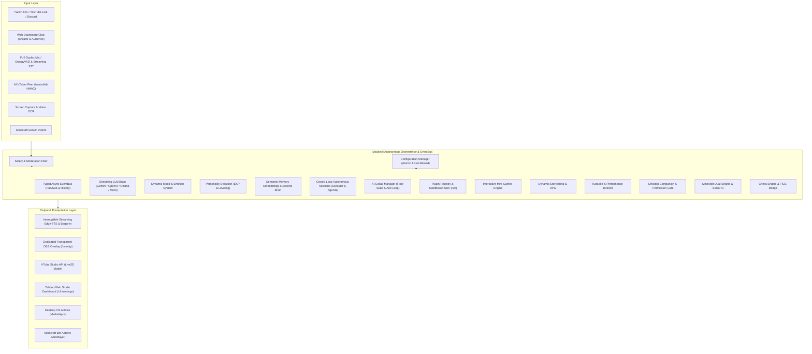

# MaybeAI — Eve Maybe (Autonomous AI VTuber)

<p align="center">
  
</p>

<p align="center">
  <strong>Autonomous AI VTuber Streamer System inspired by Neuro-sama</strong><br>
  <em>Featuring Full-Duplex Voice &amp; Barge-In, Closed-Loop Autonomous Missions, AI-to-AI Collab Protocol, Community Plugin SDK, Streaming Multi-Provider LLMs, Pipelined Sentence-Chunked Edge-TTS Lip-Sync, Dedicated Transparent OBS Overlay &amp; Tabbed Studio UI, Typed Async EventBus, Semantic Memory Embeddings, Multi-Platform Live Chat (Twitch / YouTube Live / Discord), Live2D/Canvas Rendering, Minecraft Autonomy, Screen Vision, Desktop Companion, Mini-Games, Storytelling RPG, Dynamic Karaoke Performance, and Centralized Cyberpunk Configuration Center.</em>
</p>

<p align="center">
  
  
  
  
  
  
</p>

---

## 📖 Daftar Isi (Table of Contents)
- [Tentang MaybeAI & Eve Maybe](#-tentang-maybeai--eve-maybe)
- [Arsitektur Sistem (System Architecture)](#-arsitektur-sistem)
- [Katalog Fitur Komprehensif](#-katalog-fitur-komprehensif)
  - [1. Autonomous Brain & Multi-Provider LLM](#1-autonomous-brain--multi-provider-llm)
  - [2. Edge-TTS & Dynamic Lip-Sync](#2-edge-tts--dynamic-lip-sync)
  - [3. Dual Avatar Rendering (Canvas 2D + VTS)](#3-dual-avatar-rendering)
  - [4. Centralized Cyberpunk Configuration Center](#4-centralized-cyberpunk-configuration-center)
  - [5. Dynamic Performance Director & Karaoke Engine](#5-dynamic-performance-director--karaoke-engine)
  - [6. Minecraft Dual-Mode Engine & Portable Bridge](#6-minecraft-dual-mode-engine--portable-bridge)
  - [7. Multiplayer Social Intelligence](#7-multiplayer-social-intelligence)
  - [8. Experience-Based Personality Evolution](#8-experience-based-personality-evolution)
  - [9. Visual Perception & Screen Awareness](#9-visual-perception--screen-awareness)
  - [10. Desktop Companion & Permission Gateway](#10-desktop-companion--permission-gateway)
  - [11. Interactive Mini-Game Engine](#11-interactive-mini-game-engine)
  - [12. Dynamic Storytelling & Community RPG](#12-dynamic-storytelling--community-rpg)
  - [13. Chess Engine & Streamer Commentary](#13-chess-engine--streamer-commentary)
  - [14. Goal Planning & Autonomous Agenda](#14-goal-planning--autonomous-agenda)
  - [15. User Relationships & Second Brain Memory](#15-user-relationships--second-brain-memory)
  - [16. Dynamic Mood & Emotion System](#16-dynamic-mood--emotion-system)
  - [17. Safety & Moderation Shield](#17-safety--moderation-shield)
  - [18. Full-Duplex Voice, Energy VAD & Barge-In](#18-full-duplex-voice-energy-vad--barge-in)
  - [19. Multi-Platform Live Chat & EventBus](#19-multi-platform-live-chat-twitch-youtube-live-discord-web--event-driven-core-eventbus)
  - [20. AI-to-AI Collab Protocol (/ws/collab)](#20-ai-to-ai-collab-protocol-wscollab)
  - [21. Community Plugin SDK, Subprocess Sandbox & `maybeai plugin` CLI](#21-community-plugin-sdk-subprocess-sandbox--maybeai-plugin-cli)
  - [22. Autonomous Multi-Scene OBS Showrunner, Highlights, Vertical Clips & VOD Summarizer](#22-autonomous-multi-scene-obs-showrunner-highlights-vertical-clips--vod-summarizer)
  - [23. Docker Headless Deployment](#23-docker-headless-deployment)
- [Struktur Direktori Proyek](#-struktur-direktori-proyek)
- [Panduan Instalasi & Menjalankan](#-panduan-instalasi--menjalankan)
- [Panduan Configuration Center (/settings)](#-panduan-configuration-center-settings)
- [Keamanan & Konfigurasi (Security & Config)](#-keamanan--konfigurasi-security--config)
- [Daftar Perintah Chat & Streamer (Commands)](#-daftar-perintah-chat--streamer-commands)
- [REST API & WebSocket Protocol](#-rest-api--websocket-protocol)
- [Panduan Integrasi OBS Studio](#-panduan-integrasi-obs-studio)
- [Pengujian & Jaminan Kualitas (QA Testing)](#-pengujian--jaminan-kualitas-qa-testing)

---

## 🌟 Tentang MaybeAI & Eve Maybe

**MaybeAI** adalah platform kecerdasan buatan modular yang dirancang untuk menggerakkan **Eve Maybe**, seorang AI VTuber otonom. Terinspirasi dari konsep legendaris *Neuro-sama* (karya Vedal987), Eve bukan sekadar chatbot yang berbicara teks, melainkan entitas virtual yang memiliki kepribadian kaya (cerdas, humoris, sedikit sarkas, dan kompetitif), mampu mengamati layar, memainkan game secara mandiri, berinteraksi sosial dengan audiens, menyanyi karaoke, hingga berevolusi karakternya berdasarkan pengalaman nyata selama livestreaming.

Eve terintegrasi secara *full-duplex* dengan browser Web Canvas/3D VRM, VTube Studio (Live2D), Twitch IRC, server Minecraft, dan sistem operasi desktop.

### 🏆 Progress & Milestone Summary
- **CTO Audit & Master Plan (`audit/`, `strategy/`, `research/`):** Audit arsitektur, keamanan, audio real-time, kognisi, UX, QA, serta rencana pengembangan multi-horizon selesai terdokumentasi.
- **Horizon 0 (`4c4e473`) — Security & Concurrency Hardening:** Pengetatan Origin + Creator token (`Authorization: Bearer` / `Sec-WebSocket-Protocol`), gating `GET /api/*` & `/api/metrics`, `EventBus` concurrent dispatch dengan bounded queues, serta hardening replay/skew pada `/ws/collab`.
- **Horizon 1 (`36ba58e`) — Real-Time Audio & Cognitive Loop:** Non-blocking STT offload, RMS audio-envelope lip-sync + arbitrasi `AnalyserNode` browser, perbaikan `CancelledError` pada `TTSEngine.speak_stream()`, penghentian BGM saat barge-in, shared `EmbeddingEngine` dengan proteksi *dimension-mismatch*, dan `ContextBudgetManager`.
- **Horizon 2 (`a08e435`) — Companion Intelligence, Observability & Offline VRM:** Cross-provider LLM failover (`ProviderCircuitBreaker`), `MetricsCollector` + endpoint `GET /api/metrics`, serta aset 3D VRM & font lokal di `web/vendor/` (tanpa ketergantungan CDN).
- **Horizon 3 (`1953889`) — Ecosystem, Sandbox, Collab & E2E:** `validate_outbound_url` SSRF guard (`core/security_net.py`), `plugins.granted_permissions` default-deny + isolasi sandbox worker, protokol kolaborasi dua arah (`hello`, `duet_sync`, `emote_sync`, `game_move`), clock-locked karaoke, dukungan opsional Stockfish UCI, dan suite E2E browser (`tests/test_e2e_browser.py`).
- **YouTube Song Request & AI Cover / Auto-Karaoke (`83298fa`):** Pipeline `core/youtube_karaoke.py` (URL tervalidasi SSRF, `yt-dlp` + `ffmpeg`/`demucs` + `RVCVoiceConverter`, parser lirik VTT/SRT, `data/karaoke_cache/`, `POST /api/performance/youtube`, WS `performance_action` `"youtube"`, dan kontrol bar di Dashboard UI).

---

## 🏗️ Arsitektur Sistem



---

## 🚀 Katalog Fitur Komprehensif

### 1. Autonomous Brain & Multi-Provider LLM (with Streaming)
- **Multi-Provider Architecture:** Mendukung **Google Gemini** (default: `gemini-3-flash-preview` via `config/settings.json`, otomatis *fallback* ke Mock Mode jika `GEMINI_API_KEY` belum diisi), **OpenAI** (GPT-4o / GPT-4o-mini), **Local Ollama** (Llama 3.2 / Mistral / DeepSeek), serta **Mock Mode** bawaan (bisa langsung dijalankan tanpa internet dan tanpa API key). Provider dapat di-override via `MAYBEAI_LLM_PROVIDER` atau flag `--provider`.
- **Streaming Brain-to-TTS (`llm.streaming_enabled: true`):** `Brain.generate_response_stream()` mengalirkan token secara real-time melalui Gemini SSE (`streamGenerateContent?alt=sse`), OpenAI SSE (`stream: true`), Ollama NDJSON, maupun Mock chunking sehingga Eve mulai berbicara segera setelah kalimat pertama selesai dibentuk.
- **Fallback Otomatis & Cross-Provider Failover (`ProviderCircuitBreaker`):** Mendukung `failover_enabled` dan `failover_timeout_sec` untuk berpindah otomatis antar provider LLM yang terkonfigurasi (`llm_failovers` metric) sebelum jatuh ke respons persona cadangan (`mock`) tanpa memutus siaran.
- **Context Budgeting (`ContextBudgetManager`):** Mengatur alokasi token prompt secara dinamis agar konteks percakapan, memori episodik, dan status game tetap muat dalam batas model.
- **Dynamic Emotion & Action Tags:** Brain secara cerdas membubuhkan tag ekspresi (seperti `[emotion: neutral]`, `[emotion: happy]`, `[emotion: smug]`, `[emotion: angry]`, `[emotion: blush]`, `[emotion: surprised]`, `[emotion: confused]`) dan tag aksi (`[action: giggle]`, `[action: sigh]`, `[action: wink]`) yang diparsing oleh `ActionParser` (`core/actions.py`) untuk menggerakkan ekspresi avatar secara presisi.
- **Token & Temperature Hot-Reload:** Parameter kreativitas (*temperature*) dan panjang respons (*max_tokens*) dapat diubah langsung dari Configuration Center tanpa me-restart aplikasi.

### 2. Neural TTS, RVC Singing & Dynamic Lip-Sync
- **Multi-Provider Neural TTS (`core/tts_providers.py`, `core/tts.py`):** Mendukung **Edge-TTS** (dengan modulasi prosodi berbasis emosi untuk `happy`, `excited`, `smug`, `angry`, `annoyed`, `sad`, `blush`, `whisper`), **Kokoro-82M** (lokal via `kokoro`/`kokoro_onnx` atau HTTP `kokoro_url`), **ElevenLabs** (streaming REST), dan **Custom Neural TTS** (`gpt_sovits` / `fish_speech` via `custom_tts_url`), lengkap dengan *fallback* otomatis ke Edge-TTS.
- **RVC Voice Conversion (`RVCVoiceConverter`, `core/singer.py`):** Post-processing suara bicara maupun vokal karaoke melalui server RVC (`rvc_enabled`, `rvc_url`, `rvc_pitch_shift`) dengan *fallback* bersih ke audio asli jika server offline.
- **Pipelined Sentence-Chunked Streaming (`SentenceChunker` + `TTSEngine.speak_stream()`):** Memecah aliran teks LLM per kalimat (`.`, `!`, `?`, `\n`, `~`) sambil menjaga tag `[emotion:]`/`[action:]`, singkatan, dan angka desimal tetap utuh. Kalimat $N+1$ disintesis secara konkuren saat kalimat $N$ sedang diputar, dengan pembersihan file sementara `speech_*.mp3` yang terjamin.
- **Real-Time Lip-Sync Calculation & `AnalyserNode` Arbitration:** Menghitung amplitudo RMS audio-envelope dan pergerakan fonem mulut secara proporsional (`mouth_open` 0.0 – 1.0) dengan arbitrasi `AnalyserNode` di browser agar animasi bibir avatar tetap sinkron tanpa konflik.

### 3. Dual/3D Avatar Rendering, Dedicated OBS Overlay & Stream Deck (`/deck`)
- **Dedicated Transparent OBS Overlay (`/overlay`):** Halaman khusus tanpa kontrol studio di `http://localhost:7860/overlay` (`web/overlay.html`, `overlay.css`, `overlay.js`) dengan latar belakang transparan, Canvas 2D / **3D VRM** (`?renderer=vrm&vrm_url=...`), subtitle melayang (*glassmorphic*), dan banner notifikasi Donasi/SuperChat real-time—siap pakai sebagai *Browser Source* OBS Studio.
- **3D VRM Avatar Offline (`web/vendor/`, `web/vrm-avatar.js`) & Multi-Param VTS Rigging (`core/vts_client.py`):** Mendukung toggle `2D Canvas | 3D VRM` di Studio maupun Overlay dengan aset Three.js, `@pixiv/three-vrm`, dan `fonts.css` yang sudah di-vendor secara lokal di `web/vendor/` (berjalan offline tanpa CDN), `web/shared-client.js` untuk utilitas klien bersama, serta `VTSClient.apply_mood_rig()` / `set_parameters()` untuk VTube Studio.
- **Mobile/Tablet Creator Stream Deck (`/deck`):** Antarmuka kontrol sentuh di `http://localhost:7860/deck` (`web/deck.html`, `web/deck.js`) dengan 9 pad satu sentuhan (Barge-In, Mic AudioWorklet, Mute, Mission Step/Loop, Sing, Improv, Collab Topic, Stop Speech) dan otentikasi token.
- **AudioWorklet 16 kHz STT (`web/audio-worklet-processor.js`):** Menangkap audio mikrofon melalui `MaybeAIPCMProcessor` (16 kHz mono Int16 PCM) dengan emisi event `stt_partial` & `stt_final` secara real-time.
- **Modular 4-Tab Studio Workspace (`/`):** Dashboard utama (`http://localhost:7860`) tertata dalam 4 tab workspace (*sticky nav* dengan persistensi `localStorage`): **🎤 Live Stage**, **🎮 Gaming**, **🎲 RPG & Mini-Games**, dan **🧠 Brain & Memory**, dilengkapi tombol pintas **📺 OBS Overlay** dan **🎛️ Deck**.

### 4. Centralized Cyberpunk Configuration Center
- **Dedicated GUI URL:** Halaman khusus di `http://localhost:7860/settings` dengan tema estetika Cyberpunk / Futuristic AI (aksen neon, glow cards, toggle switch, slider nilai interaktif).
- **24 Kategori Pengaturan Lengkap (`ConfigManager.DEFAULT_SETTINGS`):** Meliputi `system` (General), `llm` (termasuk `streaming_enabled`, `failover_*`), `personality`, `memory` (`embedding_provider`), `mood`, `tts` (`interruptible`), `stt` (`vad_enabled`, `vad_energy_threshold`, `barge_in_enabled`), `vts`, `avatar`, `karaoke` (termasuk pengaturan YouTube karaoke), `performance`, `twitch`, `youtube`, `discord`, `tiktok`, `moderator`, `security`, `minecraft`, `autonomous_agent` (`closed_loop_missions`, `mission_tick_interval_sec`), `collab`, `plugins` (`granted_permissions`, `enabled_plugins`), `vision`, `obs`, dan `highlights`.
- **Secret Protection:** Token OAuth Twitch (`twitch.oauth_token`), YouTube API Key (`youtube.api_key`), Discord Bot Token (`discord.bot_token`), Creator Access Token (`security.creator_token`), dan Collab HMAC Shared Secret (`collab.shared_secret`) **tidak pernah diekspos dalam bentuk plaintext** via HTTP GET (`"********"` masking) dan tidak akan terhapus jika form disimpan tanpa mengubah token.
- **Atomic Persistence:** Menggunakan mekanisme *temp-write* (`.settings.json.tmp`) dan atomic `os.replace()` untuk mencegah korupsi file saat listrik mati atau crash.
- **Live Hot-Reload:** Perubahan diterapkan seketika ke seluruh modul aktif di runtime tanpa perlu restart server.
- **Interactive Diagnostic Test Runners:** Tombol uji live probe untuk LLM, TTS, VTS, Twitch, Moderator, dan Memory langsung dari browser.

### 5. Dynamic Performance Director & Karaoke Engine
- **Otonomi Konser Musik:** Eve dapat bertindak sebagai penampil profesional yang mengatur penampilannya sendiri: memilih lagu berdasarkan mood, membawakan monolog intro (*MC speech*), mengatur ekspresi per bait lirik, dan memberikan epilog selebrasi setelah bernyanyi.
- **Playback Multi-Track & Clock-Locked Karaoke:** Memutar file instrumen BGM otomatis bersamaan dengan vokal ritmik terstruktur, sinkronisasi lirik berbasis jam (*clock-locked*), dan semburan animasi glowstick penonton di layar avatar.
- **YouTube Song Request & AI Cover / Auto-Karaoke (`core/youtube_karaoke.py`):** Mendukung permintaan lagu langsung dari URL YouTube yang tervalidasi SSRF (`validate_outbound_url`), mengunduh audio & subtitle VTT/SRT via `yt-dlp`, memisahkan vokal/instrumen dengan `ffmpeg` / `demucs` serta konversi suara opsional melalui `RVCVoiceConverter`, menyimpan cache di `data/karaoke_cache/`, dan memutar via `POST /api/performance/youtube`, WebSocket `performance_action` `"youtube"`, maupun bar kontrol di Dashboard UI.
- **Katalog Lagu Kustom:** Mudah menambahkan lagu baru melalui `config/songs.json` dan folder `assets/songs/`.

### 6. Minecraft Dual-Mode Engine & Portable Bridge
- **Zero-Setup Node.js Portable:** MaybeAI menyertakan runtime Node.js portabel internal di Windows; Anda tidak perlu menginstal Node.js secara manual di komputer!
- **Mode Santai (Casual & Social):**
  - Menyapa player saat mendekat.
  - Membalas gerakan *friendly crouch / t-bag* sebagai tanda damai.
  - Berterima kasih saat diberikan hadiah item (seperti Diamond).
  - Melakukan *head-tracking* sosial menatap wajah player terdekat dan mengikutinya (*follow player*).
- **Mode Kompe (Competitive & Speedrun):**
  - Mesin *state machine* speedrun 10 fase (Wood $\rightarrow$ Stone $\rightarrow$ Iron/Bucket $\rightarrow$ Nether Lava Portal $\rightarrow$ Blaze Rods $\rightarrow$ Piglin Trade $\rightarrow$ Eye of Ender $\rightarrow$ Stronghold $\rightarrow$ End Portal $\rightarrow$ Slay Ender Dragon).
  - Dilengkapi split timer live (`⏱️ 00:00`), komentar taktis, dan selebrasi kemenangan.
- **Guard & Combat Mode:** Radius pengawalan base otomatis (`guard_radius: 15.0`) dan mundur darurat saat darah sekarat (`health_retreat_threshold: 6`).

### 7. Multiplayer Social Intelligence
- **Multi-Player Social Cognition:** Eve mampu membedakan siapa yang sedang berbicara di server multiplayer, mengenali peran masing-masing pemain, dan mengingat kontribusi mereka di *Contribution Ledger*.
- **Team & Partnership Formation:** Memilih partner bermain berdasarkan skor reputasi dan kepercayaan (*trust score*), serta bernegosiasi saat terjadi perebutan sumber daya tambang.

### 8. Experience-Based Personality Evolution
- **Sistem Level & EXP Karakter:** Kepribadian Eve berkembang secara organik berdasarkan pengalaman yang dialaminya (EXP didapat dari memenangkan game, dipuji penonton, atau membalas roasting).
- **Evolusi Terkontrol:** Sifat kepribadian (seperti *Competitiveness*, *Friendliness*, *Humor*, dan *Confidence*) beradaptasi secara matematis dan logis tanpa merusak integritas system prompt inti.
- **Second Brain Evolution Sync:** Catatan sejarah perkembangan karakter dicatat secara rapi ke file Markdown `data/second_brain/personality/evolution.md`.

### 9. Visual Perception & Screen Awareness
- **Mata Visual untuk Eve:** Eve dapat "melihat" apa yang sedang terjadi di layar monitor menggunakan integrasi screenshot capture, OCR, computer vision, dan Vision-Language Model (VLM).
- **Komentar Spontan Layar:** Mengenali game yang sedang dimainkan, membaca status HUD game (darah, amunisi, skor), mengetahui saat pemain mengalami kekalahan (*Game Over*), dan mengomentari video YouTube yang sedang ditonton.

### 10. Desktop Companion & Permission Gateway
- **Sistem Izin Berlapis (3-Tier Risk Permission Gate):** Tindakan berisiko tinggi (membuka aplikasi atau mengeksekusi perintah shell) memerlukan izin eksplisit pengguna (*Pending Approval*), sedangkan aksi aman (mengatur volume suara atau media player) dapat langsung dieksekusi.
- **Desktop Companion Capabilities:** Mengontrol lagu (Play/Pause/Next/Volume), meluncurkan aplikasi yang diizinkan (Notepad, Calculator, Browser), membaca notifikasi, dan mengganti scene streaming.

### 11. Interactive Mini-Game Engine
- **Koleksi Game Interaktif bersama Penonton:**
  - 🧠 **Trivia Quiz:** Pertanyaan pengetahuan umum dengan sistem poin.
  - 🔢 **Guess the Number:** Tebak angka rahasia dengan petunjuk lebih tinggi/lebih rendah.
  - 🔤 **Word Association:** Permainan sambung asosiasi kata kreatif.
  - 🧩 **Riddle Challenge:** Teka-teki asah otak.
  - 🤔 **Would You Rather:** Pilihan dilema seru antara dua opsi.
  - 🎵 **Guess the Song:** Tebak lirik atau judul lagu.
- **Twitch Chat Integration:** Penonton di Twitch chat atau Web chat dapat menjawab langsung, mencetak rekor *streak*, dan masuk ke papan peringkat (*Leaderboard*).

### 12. Dynamic Storytelling & Community RPG
- **Petualangan Interaktif Berkelanjutan:** Eve bertindak sebagai Game Master (DM) atau teman petualangan RPG bersama penonton.
- **Community Chat Voting:** Kelanjutan jalan cerita ditentukan oleh voting terbanyak dari pilihan interaktif penonton di live chat.
- **D20 Dice Roll Mechanics:** Sistem lempar dadu keberuntungan untuk menentukan keberhasilan aksi karakter (Critical Success, Normal, Fail, Fumble).
- **Inventory & Story Chronicles:** Inventaris party disimpan dan kronik cerita dicatat ke `data/second_brain/storytelling/campaigns.md`.

### 13. Chess Engine & Streamer Commentary
- **Integrasi Papan Catur FICS / Stockfish UCI & Alpha-Beta Fallback:** Eve dapat bermain catur dengan validasi langkah legal, pembacaan notasi FEN/PGN, level kesulitan ELO (800–2000), serta dukungan opsional binary **Stockfish UCI** (otomatis *fallback* ke engine `alpha_beta` bawaan bila binary `stockfish` tidak terpasang).
- **Komentar Catur Cerdas:** Eve mengomentari blunder pemain lawan, memamerkan taktik cerdiknya (*smug banter*), dan memberikan evaluasi posisi pasca-permainan.

### 14. Goal Planning & Closed-Loop Autonomous Missions
- **Closed-Loop Mission Executor (`core/planning/executor.py`):** `AutonomousMissionExecutor` menjalankan siklus otonom berkala (*select goal $\rightarrow$ plan domain action $\rightarrow$ execute $\rightarrow$ evaluate & sync `agenda.md`*) secara langsung untuk 4 domain: **Minecraft** (`santai` / `kompe` / `guard`), **Chess** (`start_game` / `make_bot_move`), **Performance Director** (`perform_song`), dan **Social Outreach**.
- **Failure Replanning (`StrategyReplanner`):** Jika aksi misi gagal atau melempar error, executor otomatis beralih ke `StrategyReplanner` untuk membuat subtugas *Plan B*, menyuarakan adaptasi strategi, dan memperbarui `data/goals/agenda.md`.
- **Human-in-the-Loop Approval Gate:** Bila `autonomous_agent.human_approval_required` diaktifkan, langkah misi akan menunggu persetujuan Creator (`approve` / `reject`) melalui tab **🧠 Brain & Memory** atau REST API `/api/missions/step`.
- **Idle Banter Scheduler:** Jika chat sepi dalam interval tertentu, Eve secara proaktif membuka topik pembicaraan baru atau menceritakan pengalamannya agar stream tetap hidup.

### 15. User Relationships, Semantic Embeddings & Second Brain Memory
- **Multi-Backend Semantic Embeddings (`core/memory/embedding.py`):** Mendukung provider `auto | local | gemini | openai | hash` (otomatis memilih `sentence-transformers`/`fastembed` lokal, Gemini `text-embedding-004`, OpenAI `text-embedding-3-small`, atau *sublinear-TF hash* offline dengan LRU cache dan keamanan *dimension-mismatch* pada `MemoryDatabase` & `MemoryRetriever`).
- **Profil Hubungan Per Penonton (Viewer Dossier):** Eve mengingat siapa saja penontonnya, melacak frekuensi obrolan, skor keakraban (*Familiarity*), tingkat kepercayaan (*Trust*), hubungan rivalitas (*Rivalry*), dan kasih sayang (*Affection*).
- **Shared Inside Jokes:** Mencatat lelucon lokal dan kenangan khusus bersama penonton tertentu ke dalam file Markdown tersinkronisasi di folder `data/second_brain/relationships/`.

### 16. Dynamic Mood & Emotion System
- **5-Dimensi Emosi Real-Time:** *Happiness*, *Annoyance*, *Curiosity*, *Excitement*, dan *Competitiveness*.
- **Decay & Sensitivity Dynamics:** Emosi Eve berubah sesuai situasi (dipuji penonton meningkatkan *Happiness*, di-troll atau kalah game meningkatkan *Annoyance/Competitiveness*) dan secara bertahap mereda kembali ke *baseline* alaminya.

### 17. Safety & Moderation Shield
- **Perlindungan Terhadap Pelanggaran:** Filter kata-kata terlarang (*banned words regex*), pembatasan panjang pesan, deteksi spam beruntun, serta deteksi heuristik untuk mencegah serangan *prompt injection* / *jailbreak*.

### 18. Full-Duplex Voice, Energy VAD & Barge-In
- **Energy VAD & Streaming STT (`core/stt.py`):** Dilengkapi `EnergyVAD` (deteksi RMS PCM16/float32 dengan *onset hysteresis* dan *hangover smoothing*) serta `StreamingSTTSession` yang menyangga fragmen audio mikrofon secara real-time, memicu event `voice_vad_state`, dan mentranskripsi via `faster-whisper`, `openai-whisper`, OpenAI Whisper API, atau fallback offline `mock`.
- **Instant Creator Barge-In (`core/tts.py`, `core/orchestrator.py`):** Saat suara Creator terdeteksi ketika Eve sedang berbicara, `Orchestrator.barge_in()` langsung menghentikan `TTSEngine.speak()` maupun `speak_stream()` via `TTSEngine.stop()`, membatalkan task interaksi aktif tanpa *deadlock* pada `_busy_lock`, membersihkan file `speech_*.mp3`, mereset mulut avatar ke `0.0`, dan memancarkan `voice_barge_in`.
- **Live Web Audio VAD Dock (`web/app.js`):** Panel Creator Voice Dock menampilkan meter energi mikrofon real-time (`#vad-energy-fill`), toggle **Barge-In** (`#chk-barge-in`), serta lencana interupsi (`#barge-in-badge`).

### 19. Multi-Platform Live Chat (Twitch, YouTube Live, Discord, Web) & Event-Driven Core (`EventBus`)
- **Multi-Platform Adapter Registry (`core/platforms/`, `core/chat_receiver.py`):**
  - **Twitch IRC:** Terhubung ke server Twitch IRC port 6667 dengan dukungan token OAuth, anti-spam cooldown, dan mention filter.
  - **YouTube Live (`YouTubeLiveAdapter`):** Polling YouTube Data API v3 (`liveChatMessages`) via `aiohttp`, otomatis memetakan **SuperChat** dan **SuperSticker** menjadi event donasi (`is_donation=True`, `source="youtube"`).
  - **Discord (`DiscordAdapter`):** Polling Discord REST API v10 menggunakan Bot Token & Channel ID (`source="discord"`), memfilter pesan bot, dan terdegradasi aman saat tidak dikonfigurasi.
- **Typed Async EventBus (`core/event_bus.py`):** Menghubungkan `Orchestrator`, `ConversationEngine`, dan WebSocket broadcast melalui pub/sub asinkron dengan dukungan wildcard `*`, isolasi exception per handler, *ring buffer* riwayat event, dan endpoint diagnostik `GET /api/eventbus/stats`.
- **Pemisahan Jalur Komunikasi (Dual Channel Tabs):**
  - **👑 Tab Chat Saya (Creator VIP):** Jalur eksklusif streamer dengan prioritas antrian absolut (`priority_score = 350.0`, melompati antrian penonton umum dan saweran). Dilengkapi dock mikrofon bawaan (Web Speech STT / Whisper) untuk berbicara langsung secara verbal ke Eve.
  - **👥 Tab Stream Chat (Penonton Publik):** Jalur pesan publik (Twitch, YouTube, Discord, & penonton web). Pesan masuk ke antrian kurasi reguler dan dievaluasi berdasarkan relevansi, saweran, atau topik perdebatan.
- **Strict Permission Guardrails:** Perintah krusial sistem (peluncuran aplikasi Desktop Companion `!desktop`, pergantian mode gameplay/server Minecraft `!mc mode/server`, dan reset/pengaturan ELO catur `!chess elo/new`) diproteksi penuh dan hanya dapat dijalankan oleh Creator. Jika penonton mencoba mengeksekusinya, Eve akan menolak dengan nada sarkas khasnya tanpa mengeksekusi aksi fisik pada sistem.

### 20. AI-to-AI Collab Protocol (`/ws/collab`)
- **Signed Wire Envelope & Replay Protection (`core/collab/protocol.py`):** `CollabEnvelope` (`protocol_version: "1.0"`) mendukung event `hello` (capability handshake), `turn_utterance`, `turn_yield`, `duet_sync`, `game_move`, `emote_sync`, `ping`, dan `bye` dengan penandatanganan HMAC-SHA256, verifikasi constant-time (`hmac.compare_digest`), cache *nonce replay*, serta pemeriksaan *timestamp skew*.
- **Bidirectional Orchestrator Sync (`core/collab/manager.py`):** `CollabManager` mengelola *floor state machine* (`idle`, `speaking`, `yielding`, `listening`, `cooldown`), pemulihan cooldown, pembatasan `max_collab_turns` & per-type rate limits, serta menghubungkan `duet_sync`/`emote_sync`/`game_move` dua arah langsung ke `Orchestrator` (`Singer`, `VTSClient`, `ChessController`).
- **Studio Controls & Peer WebSocket (`run.py`, `web/index.html`):** Mendukung koneksi outbound ke peer maupun inbound pada `/ws/collab` dengan panel **AI Collab** (`#collabCard`) di tab **🎤 Live Stage**.

### 21. Community Plugin SDK, Subprocess Sandbox & `maybeai plugin` CLI
- **Out-of-Process Subprocess Sandbox & Default-Deny Permissions (`core/plugins/sdk.py`, `core/plugins/sandbox_worker.py`, `core/plugins/registry.py`):** Plugin eksternal di `plugins/*.py` diekstrak manifest-nya secara statis via AST dan dijalankan secara terisolasi di proses terpisah melalui JSON-RPC 2.0 stdio (`python -m core.plugins.sandbox_worker`) tanpa fallback `inprocess` untuk plugin eksternal. Worker berjalan di direktori terisolasi dengan **stripped `os.environ`** (rahasia host tidak diwariskan), kebijakan **default-deny** melalui `plugins.granted_permissions`, serta `proc.kill()` paksa bila hook melewati `hook_timeout_sec`.
- **Plugin Developer CLI (`core/plugins/cli.py`, `pyproject.toml`):** Tersedia perintah `maybeai plugin init <name>`, `maybeai plugin test <path>`, dan `maybeai plugin pack <path>` (juga via `python -m core.plugins.cli`).
- **Built-in Word Chain (`!sambungkata` / `!wc`):** Plugin komunitas interaktif (`core/plugins/word_chain.py`) di mana penonton dan creator bermain sambung huruf terakhir (`!wc start`, `!wc <kata>`, `!wc score`, `!wc stop`) lengkap dengan papan skor dan pencegahan pengulangan kata.

### 22. Autonomous Multi-Scene OBS Showrunner, Highlights, Vertical Clips & VOD Summarizer
- **OBS WebSocket v5 Showrunner (`core/desktop/obs_client.py`):** `OBSWebSocketClient` (menggunakan opsional `obsws-python>=1.6.1`, *graceful offline fallback* bila OBS belum berjalan) terhubung ke `DesktopController`, `AutonomousMissionExecutor` (`social` $\rightarrow$ `Just Chatting`, `minecraft` $\rightarrow$ `Minecraft`, `chess` $\rightarrow$ `Chess`, `performance` $\rightarrow$ `Karaoke Stage`), `PerformanceDirector`, dan `CollabManager` (`Collab Split-Screen`), serta memancarkan event `obs_scene_changed`.
- **Highlight Auto-Marker (`core/highlights/detector.py`):** `HighlightDetector` memantau `EventBus` untuk lonjakan chat (*chat burst*), donasi/SuperChat, barge-in suara Creator, penyelesaian goal, lonjakan mood, dan momen performa dengan deduplikasi *cooldown*, tombol manual (`mark_manual()`), serta pemicu `save_replay_buffer()` OBS.
- **Vertical Clip Pipeline & VOD Summarizer (`core/highlights/clipper.py`, `core/highlights/vod_summarizer.py`):** `ClipPipeline` menyusun argumen `ffmpeg` `1080x1920` (9:16) secara aman via `asyncio.create_subprocess_exec` (tanpa `shell=True`), sedangkan `VODSummarizer` menulis laporan sesi Markdown ke `data/second_brain/streams/YYYY-MM-DD.md` saat shutdown (`vod_summary_enabled=true`).

### 23. Docker Headless Deployment
- **Container & Compose (`Dockerfile`, `docker-compose.yml`, `.dockerignore`):** Profil container Python 3.12-slim headless (`MAYBEAI_HEADLESS=1`) lengkap dengan `ffmpeg`, user non-root `maybeai`, volume persisten untuk `config/`, `data/`, `plugins/`, dan `data/clips/`, serta `HEALTHCHECK` ke `GET /api/health`.

---

## 📁 Struktur Direktori Proyek

```
MaybeAI/
├── assets/
│   └── songs/
│       └── digital_world_bgm.wav  # Instrumen BGM karaoke
├── audit/                         # Laporan CTO Audit (00..11 & FINAL_AUDIT_REPORT.md)
├── config/
│   ├── settings.json              # Konfigurasi master (24 section: General, LLM, TTS, STT, Security, dll)
│   ├── character.json             # Persona, latar belakang, lore, & gaya bicara Eve
│   ├── filter_words.json          # Blacklist kata & aturan moderasi regex
│   ├── songs.json                 # Katalog lagu karaoke, lirik, & delay timing
│   └── minecraft_servers.json     # Daftar server Minecraft tersimpan
├── core/
│   ├── actions.py                 # Parser tag [emotion: x] dan [action: x]
│   ├── brain.py                   # Otak LLM Streaming, ContextBudgetManager, & ProviderCircuitBreaker
│   ├── event_bus.py               # Typed Async Pub/Sub EventBus (concurrent dispatch & bounded queues)
│   ├── metrics.py                 # MetricsCollector & telemetri runtime (/api/metrics)
│   ├── security_net.py            # Guard SSRF & DNS-rebinding (validate_outbound_url)
│   ├── tts.py                     # Pipelined Streaming TTS & RMS Lip-Sync Engine
│   ├── tts_providers.py           # Neural TTS Providers (Edge, Kokoro, ElevenLabs, Custom) & RVC
│   ├── vts_client.py              # Client WebSocket VTube Studio API (Multi-Param Rigging)
│   ├── youtube_karaoke.py         # Pipeline YouTube Song Request & AI Cover / Auto-Karaoke
│   ├── chat_receiver.py           # Ingestion Twitch IRC (TLS/IRCv3), Web Chat, & Multi-Platform Registry
│   ├── collab/                    # AI-to-AI Collab Protocol (CollabEnvelope HMAC, Replay Cache, & Manager)
│   ├── platforms/                 # Adapter Live Chat (YouTube Live, Discord Gateway, TikTok Live)
│   ├── highlights/                # HighlightDetector, ClipPipeline (9:16 ffmpeg), & VODSummarizer
│   ├── plugins/                   # Community Plugin SDK, Isolated Sandbox Worker, CLI, & WordChainPlugin (!wc)
│   ├── moderator.py               # Filter keamanan, spam, & prompt injection
│   ├── singer.py                  # Player BGM Karaoke & sinkronisasi lirik clock-locked
│   ├── stt.py                     # Full-Duplex EnergyVAD, StreamingSTTSession, & Non-Blocking STT
│   ├── orchestrator.py            # Event loop pusat, barge-in, missions, collab, plugins, & EventBus
│   ├── config_manager.py          # Centralized Config Engine, Atomic Save, Masking, & Diagnostics
│   ├── chess/                     # Modul logika catur, Stockfish UCI / alpha-beta fallback, & komentar
│   ├── conversation/              # Manajemen konteks percakapan & memory window
│   ├── desktop/                   # Desktop Companion, App launcher, & Permission gate
│   ├── memory/                    # Semantic Embeddings, Episodic memory, & Second Brain sync
│   ├── minecraft/                 # Minecraft engine, Casual & Speedrun agents, Controller
│   │   └── multiplayer/           # Multiplayer Social Intelligence & Contribution ledger
│   ├── minigames/                 # Interactive Mini-Games Engine (Trivia, Riddle, dll)
│   ├── mood/                      # Dynamic Mood Engine & Emotional Axes
│   ├── performance/               # Dynamic Performance Director & Setlist manager
│   ├── personality/               # Experience-Based Personality Evolution Engine
│   ├── planning/                  # Goal Planning, StrategyReplanner, & AutonomousMissionExecutor
│   ├── relationship/              # User Dossiers & Social Affinity Matrix
│   ├── storytelling/              # Dynamic Storytelling & Community RPG Engine
│   └── vision/                    # Screen Capture, Vision OCR, & VLM Engine
├── data/
│   ├── memory.db                  # Database SQLite memori percakapan
│   ├── desktop/permissions.json   # Log izin dan riwayat aksi sistem desktop
│   ├── goals/agenda.md            # Markdown agenda misi streaming otonom
│   ├── karaoke_cache/             # Cache audio/stem/lirik hasil YouTube Karaoke pipeline
│   ├── minigames/leaderboard.json # Papan skor mini-game
│   ├── personality/evolution.json # Data level, EXP, & sifat kepribadian
│   ├── relationships/             # JSON data relasi user
│   └── second_brain/              # Direktori catatan Markdown otomatis (Dossier, Setlist, Streams, dll)
├── minecraft/
│   ├── bot.js                     # Entrypoint bot Mineflayer
│   ├── casual.js                  # Modul perilaku casual & sosial Minecraft
│   ├── guard.js                   # Modul bodyguard & proteksi player
│   ├── speedrun.js                # State machine speedrun 10 fase
│   ├── config.json                # Konfigurasi koneksi bot Mineflayer
│   ├── package.json               # Dependensi Node.js Mineflayer
│   ├── node/                      # Runtime Node.js portabel (Windows)
│   └── node_modules/              # Paket Node.js terbundel
├── research/                      # Proposal arsitektur, eksperimen, & technology radar
├── strategy/                      # Master Plan pengembangan, Roadmap, & Risk Register
├── web/
│   ├── index.html                 # Tabbed Web Studio Dashboard & 2D Canvas / 3D VRM Avatar
│   ├── style.css                  # Styling Cyberpunk dashboard, workspace tabs, & HUD
│   ├── app.js                     # Logika Web client, workspace tabs, AnalyserNode, & WebSocket
│   ├── shared-client.js           # Utilitas klien bersama (auth header/subprotocol, escapeHtml, dll)
│   ├── overlay.html               # Dedicated Transparent OBS Browser Source Overlay (/overlay)
│   ├── overlay.css                # Styling transparan OBS, floating subtitles, & donation alert
│   ├── overlay.js                 # Renderer avatar & subtitle real-time untuk OBS Overlay
│   ├── settings.html              # Antarmuka Cyberpunk Configuration Center
│   ├── settings.css               # Styling khusus Configuration Center
│   ├── settings.js                # Form engine (XSS-escaped), secret protection, & test runner
│   ├── deck.html                  # Mobile/Tablet Creator Stream Deck (/deck)
│   ├── deck.css                   # Styling Creator Stream Deck
│   ├── deck.js                    # Logika Stream Deck & AudioWorklet mic
│   ├── audio-worklet-processor.js # AudioWorklet 16 kHz PCM16 processor
│   ├── vrm-avatar.js              # Renderer 3D VRM Avatar (Three.js + @pixiv/three-vrm)
│   └── vendor/                    # Aset lokal offline (three.module.js, three-vrm.module.js, GLTFLoader.js, BufferGeometryUtils.js, fonts.css)
├── tests/
│   ├── __init__.py                # Menetapkan MAYBEAI_LLM_PROVIDER=mock saat test berjalan
│   ├── test_guard_runner.js       # Uji unit guard mode Minecraft (Node.js)
│   └── test_*.py                  # 43 modul pengujian unit, integrasi, & E2E Python (381 tests)
├── Dockerfile                     # Image headless Python 3.12-slim + ffmpeg & /api/health
├── docker-compose.yml             # Orkestrasi layanan MaybeAI & volume persisten
├── pyproject.toml                 # Metadata proyek, CLI entry point (`maybeai`), & extras (`[obs]`, `[tts-local]`, `[tiktok]`, dll)
├── run.py                         # FastAPI Web Server & Application Launcher
├── requirements.txt               # Daftar dependensi Python
├── start.bat                      # One-click Windows launcher (.venv, pip install, .env, run.py)
├── LICENSE                        # Lisensi MIT (EvanH 2026)
├── push.bat                       # Skrip utilitas push Git (Windows)
├── .env.example                   # Template variabel lingkungan (.env)
└── .env                           # Konfigurasi kunci rahasia lokal (tidak di-commit)
```

---

## 💻 Panduan Instalasi & Menjalankan

### 1. Prasyarat Sistem & Dependensi Opsional
- **Sistem Operasi:** Windows 10 / 11 (64-bit) atau Linux (untuk Docker headless).
- **Python:** Python versi **3.11** atau **3.12**.
- **Koneksi Internet:** Diperlukan untuk mengunduh library dan menggunakan provider online (Gemini / OpenAI / Edge-TTS). Mode `mock` dan aset 3D VRM lokal (`web/vendor/`) dapat berjalan offline.
- **Binary & Paket Opsional (dengan *Graceful Fallback*):**
  | Komponen Opsional | Fungsi | Fallback jika Tidak Terpasang |
  |---|---|---|
  | `yt-dlp`, `ffmpeg`, `demucs` | Unduh YouTube Karaoke, pemisahan stem vokal/BGM, dan pemotongan klip vertikal 9:16 (`ClipPipeline`) | Pemutaran katalog lokal (`assets/songs/`); klip video & stem separation YouTube dilewati dengan pesan diagnostik bersih |
  | `stockfish` (binary UCI) | Engine catur kompetitif berbasis UCI | Otomatis *fallback* ke engine `alpha_beta` bawaan |
  | `playwright` | Pengujian E2E browser otomatis (`tests/test_e2e_browser.py`) | Test E2E browser otomatis di-*skip* (`1 skipped`) tanpa menggagalkan suite unit |
  | `obsws-python` | Kontrol scene & replay buffer OBS Studio v5 | `OBSWebSocketClient` berjalan dalam mode offline aman |
  | `faster-whisper` | Transkripsi STT lokal berkecepatan tinggi | *Fallback* ke Whisper API atau mode `mock` |
  | `sentence-transformers` | Semantic embedding lokal di `EmbeddingEngine` | *Fallback* ke Gemini/OpenAI embedding atau *sublinear-TF hash* offline |
  | `kokoro` | Sintesis Neural TTS lokal Kokoro-82M | *Fallback* ke Edge-TTS |
  | **Layanan Eksternal:** RVC Server, VTube Studio, OBS Studio | Konversi suara AI cover/TTS, Live2D rigging, & live scene switching | Sistem tetap berjalan normal menggunakan audio asli & Canvas/VRM browser |

### 2. Setup Virtual Environment & Dependensi
Buka terminal PowerShell pada direktori proyek:

```powershell
# Buat virtual environment jika belum ada
python -m venv .venv

# Aktifkan virtual environment
.\.venv\Scripts\Activate.ps1

# Upgrade pip dan install dependensi
python -m pip install --upgrade pip
pip install -r requirements.txt
```

### 3. Konfigurasi File Lingkungan (`.env`)
Salin `.env.example` menjadi `.env` di folder root lalu isi sesuai kebutuhan:

```env
# Override provider LLM (opsional: gemini | openai | ollama | mock)
MAYBEAI_LLM_PROVIDER=

# Google Gemini (Default provider di settings.json: gemini-3-flash-preview)
GEMINI_API_KEY=AIzaSy...

# OpenAI (Opsional)
OPENAI_API_KEY=sk-...

# Security & Creator Access (Opsional)
MAYBEAI_CREATOR_TOKEN=

# Twitch IRC (Opsional jika ingin membaca chat Twitch)
TWITCH_OAUTH_TOKEN=oauth:...
TWITCH_CHANNEL=nama_channel_kamu
TWITCH_BOT_NICK=EveMaybe

# YouTube Live Chat & Discord (Opsional)
YOUTUBE_API_KEY=
DISCORD_BOT_TOKEN=
MAYBEAI_EMBEDDING_PROVIDER=

# AI Collab Protocol (/ws/collab, Opsional)
MAYBEAI_COLLAB_SECRET=
```

### 4. Menjalankan Aplikasi

#### A. Mode Bawaan (Default `gemini` dengan Fallback Otomatis ke Mock Mode)
Secara default, `config/settings.json` menggunakan provider `gemini` (`gemini-3-flash-preview`). Jika `GEMINI_API_KEY` belum diatur, sistem otomatis *fallback* ke Mock Mode tanpa API key:
```powershell
.\.venv\Scripts\python.exe run.py
```
Untuk memaksa mode Mock murni secara eksplisit:
```powershell
.\.venv\Scripts\python.exe run.py --provider mock
```
Akses di browser Anda: 👉 **`http://localhost:7860`**

#### B. Menggunakan Google Gemini
```powershell
.\.venv\Scripts\python.exe run.py --provider gemini
```

#### C. Menggunakan OpenAI GPT-4o
```powershell
.\.venv\Scripts\python.exe run.py --provider openai
```

#### D. Menggunakan Local Ollama
Pastikan aplikasi [Ollama](https://ollama.com/) sudah aktif di komputer Anda:
```powershell
ollama run llama3.2
.\.venv\Scripts\python.exe run.py --provider ollama
```

---

## ⚙️ Panduan Configuration Center (`/settings`)

Akses halaman kontrol konfigurasi di: 👉 **`http://localhost:7860/settings`**  
*(Atau klik tombol **⚙️ Configuration Center** di bagian atas Web Dashboard utama).*

### Fitur Utama Configuration Center:
1. **Navigasi Sidebar Responsif:** **24 kategori** pengaturan tingkat atas (sesuai `ConfigManager.DEFAULT_SETTINGS`, termasuk `obs`, `highlights`, `stt`, `security`, `youtube`, `discord`, `tiktok`, `avatar`, `collab`, dan `plugins`) plus tampilan *System Diagnostics* dengan ikon khas cyberpunk.
2. **Pencarian Real-Time (*Search Box*):** Menemukan pengaturan apapun hanya dengan mengetikkan kata kunci (contoh: *temperature*, *streaming*, *failover*, *embedding*, *youtube*, *discord*, *token*, *stt*, *vad*, *barge*, *collab*, *plugins*).
3. **Perlindungan Token, Masking & XSS Escaping:** Secret sensitif seperti `llm.*_api_key`, `twitch.oauth_token`, `youtube.api_key`, `discord.bot_token`, `security.creator_token`, `obs.password`, dan `collab.shared_secret` disamarkan menjadi `********` dan dipertahankan saat penyimpanan atomik bila tidak diubah. Seluruh input/label pada `/settings` di-escape (`escapeHtml`) untuk mencegah DOM XSS.
4. **Live Slider & Toggle:** Setiap slider menampilkan nilai numerik secara *real-time*, ditambah editor list interaktif untuk `security.allowed_origins` dan `plugins.enabled_plugins`.
5. **Indikator Unsaved Changes:** Memunculkan banner konfirmasi di bawah layar saat terdapat perubahan yang belum disimpan.
6. **Shortcut Keyboard:** Tekan **`Ctrl + S`** di halaman settings untuk menyimpan secara instan.
7. **Penyimpanan Atomik & Hot-Reload:** Perubahan pada LLM, TTS, VTS, Moderator, Karaoke, STT/VAD, Security, Autonomous Missions, Collab, dan Plugins langsung diterapkan seketika tanpa perlu restart proses.
8. **Interactive Feature Test Runner:** Tekan tombol **Run Test / Probe** di tiap kategori untuk menguji fungsionalitas modul secara langsung.

---

## 🔐 Keamanan & Konfigurasi (Security & Config)

MaybeAI menerapkan kontrol akses ketat untuk melindungi endpoint kontrol dan eksekusi lokal:

- **Validasi Origin (`Origin` Check):**
  - Seluruh endpoint `/api/*` (termasuk `GET /api/*` dan `GET /api/metrics` bila token dikonfigurasi) serta koneksi WebSocket `/ws` dan `/ws/collab` memeriksa header `Origin` jika disertakan oleh browser/klien.
  - Secara default hanya origin localhost (`http://127.0.0.1:<port>`, `http://localhost:<port>`, `http://[::1]:<port>`, atau `https://`) serta entri yang didaftarkan di `security.allowed_origins` (`config/settings.json` / `/settings`) yang diizinkan.
  - Origin asing ditolak dengan **HTTP `403`** pada `/api/*` dan penutupan WebSocket kode **`1008`** pada `/ws`.
- **Otentikasi Creator Token (`Authorization: Bearer` / `Sec-WebSocket-Protocol` & `MAYBEAI_CREATOR_TOKEN`):**
  - Klien WebSocket tidak lagi dipercaya berdasarkan `is_creator` dari payload JSON atau nama user.
  - Hak Creator hanya diberikan jika koneksi berasal dari alamat loopback (`127.0.0.1`, `::1`, `localhost`, `::ffff:127.0.0.1`).
  - Jika token dikonfigurasi melalui environment variable `MAYBEAI_CREATOR_TOKEN` (prioritas utama) atau `security.creator_token` di `config/settings.json`, endpoint `/api/*` dan WebSocket `/ws` memverifikasi token secara non-query melalui header **`Authorization: Bearer <token>`** atau subprotocol **`Sec-WebSocket-Protocol`** (menggunakan `secrets.compare_digest`), sehingga token tidak bocor ke log URL query string. Tanpa token yang valid, akses `/api/*` ditolak (`401`/`403`) dan pada `/ws` `is_creator` dipaksa `False` dengan source `"creator"`/`"mic"` diturunkan menjadi `"web"`.
  - Di Web Dashboard (`web/shared-client.js`, `web/app.js`), token disimpan di `localStorage.maybeai_creator_token` (atau diinput via UI `/settings`) dan dikirim otomatis lewat `Authorization: Bearer` serta `Sec-WebSocket-Protocol`.
  - Jika tidak ada token yang dikonfigurasi, klien loopback tetap mendapatkan akses Creator secara default agar dashboard lokal langsung berfungsi.
- **Guard SSRF (`core/security_net.py`) & Plugin Default-Deny (`plugins.granted_permissions`):**
  - URL outbound (seperti YouTube Song Request dan webhook/peer eksternal) divalidasi oleh `validate_outbound_url()` untuk memblokir IP privat/loopback/link-local serta mencegah serangan DNS rebinding.
  - Plugin eksternal menerapkan kebijakan **default-deny** melalui `plugins.granted_permissions` dan dijalankan di worker proses terpisah dengan direktori terisolasi serta environment bersih.
- **Override Provider LLM (`MAYBEAI_LLM_PROVIDER`):**
  - Menetapkan `MAYBEAI_LLM_PROVIDER` (misal `mock`, `gemini`, `openai`, `ollama`) akan menimpa `llm.provider` dari `config/settings.json` secara langsung (sangat berguna untuk pengujian otomatis maupun isolasi offline).
- **Kategori Baru & Pengaturan Fase 2 di `/settings` (`tts`, `twitch`, `discord`, `tiktok`, `vision`, `avatar`, `stt`, `security`, `collab`, `plugins`):**
  - **`tts`:** `provider` (`edge-tts` | `kokoro` | `elevenlabs` | `gpt_sovits` | `fish_speech`), `rvc_enabled`, `rvc_url`, `rvc_pitch_shift`, `kokoro_url`, `custom_tts_url`, `elevenlabs_voice_id`.
  - **`twitch` / `discord` / `tiktok`:** `twitch.use_tls`, `twitch.port` (IRCv3 tags `bits`/`sub`/`raid`), `discord.use_gateway`, `discord.reply_enabled`, serta kategori **`tiktok`** (`enabled`, `username`).
  - **`vision` & `avatar`:** `vision.vlm_enabled`, `vision.vlm_interval_sec` (`aperceive_with_vlm()`), serta kategori **`avatar`** (`renderer`: `canvas` | `vrm`, `vrm_url`).
  - **`stt`, `security`, `collab`, `plugins`, `obs`, `highlights`:** Mengatur AudioWorklet/EnergyVAD/barge-in, token akses creator (`********`), kolaborasi AI peer-to-peer (`duet_sync`, `emote_sync`, `game_move`), lifecycle & `sandbox_mode` plugin SDK, kredensial OBS WebSocket v5 (`obs.password` dimasking `********`), serta threshold auto-highlight & VOD summary (`highlights`).
- **Otentikasi `/ws/collab` & Aksi Creator-Only `/ws`:**
  - Endpoint peer `/ws/collab` memverifikasi `MAYBEAI_COLLAB_SECRET` / `collab.shared_secret` menggunakan `hmac.compare_digest` (atau mewajibkan alamat loopback bila secret belum diset), serta memvalidasi tanda tangan HMAC-SHA256 pada `CollabEnvelope`.
  - Event `/ws` sensitif (`barge_in`, `voice_audio_chunk`, `mission_action`, serta mutasi `collab_action` & `plugin_action`) ditolak dengan `{"type": "error", "data": {"code": "forbidden"}}` jika pengirim bukan Creator terotorisasi.
- **Eksekusi Desktop Companion Aman:** `DesktopController` meluncurkan aplikasi hanya dari *allow-list* terverifikasi tanpa `shell=True` dan menolak input yang mengandung metakarakter shell.

---

## 🎮 Daftar Perintah Chat & Streamer (Commands)

Anda dapat mengetik perintah ini di **Interactive Web Chat** atau di **Twitch Live Chat** (aksi UI lanjutan untuk Mini-Games, Story RPG, dan Performance Director juga tersedia langsung melalui panel dashboard / REST API / WebSocket):

| Kategori | Perintah / Contoh Chat | Deskripsi Aksi |
|---|---|---|
| **Karaoke & Panggung** | `!sing` / `!sing digital_world` | Meminta Eve menyanyikan lagu (opsional dengan `song_id`, misal `digital_world`) lengkap dengan BGM. |
| | *"Eve coba nyanyi dong"* | Perintah natural untuk memicu penampilan karaoke. |
| | `!glowstick`, `!cheer`, `!clap`, `!encore` | Memberikan sorakan audiens / glowstick / permintaan encore selama penampilan berlangsung. |
| **Improv & Interaksi** | `!improv` | Memicu monolog spontan atau komentar *shower thought* Eve ke chat. |
| | `!roleplay <peran>` / `!roleplay stop` | Mengaktifkan atau menghentikan mode roleplay karakter tertentu. |
| | `!opinion` / `!hottake <topik>` | Meminta opini tegas atau *hot take* khas Eve. |
| | `!roast` | Meminta Eve me-roast pengirim pesan secara bercanda. |
| | `!story [tema]` | Memicu respons cerita/dongeng personal dan menyimpan catatan cerita ke memori episodik. |
| **Minecraft** | `!mc mode santai` *(Creator-only)* | Mengubah mode Minecraft ke mode sosial interaktif. |
| | `!mc mode kompe` *(Creator-only)* | Memulai speedrun Minecraft dari fase 1. |
| | `!mc next` *(Creator-only)* | Memajukan fase speedrun ke milestone berikutnya. |
| | `!mc guard <player>` | Meminta Eve menjaga/mengawal pemain tertentu. |
| | `!mc follow` / `!mc stop` / `!mc jump` / `!mc crouch` / `!mc dance` / `!mc gift` | Mengontrol aksi bot Minecraft di server. |
| **Catur** | `!chess new [white\|black]` / `!catur new` *(Creator-only)* | Memulai permainan catur baru melawan Eve. |
| | `!chess elo <800-2000>` / `!catur elo <angka>` *(Creator-only)* | Mengatur level ELO engine catur Eve. |
| | `!chess move <langkah>` / `!catur move <langkah>` | Mengirim langkah catur dalam format UCI/SAN (contoh: `e2e4`). |
| | `!chess resign` / `!catur resign` *(Creator-only)* | Mengakhiri/menyerah pada permainan catur aktif. |
| **Mini-Games** | `!A` / `!B` | Memilih opsi saat ronde *Would You Rather* aktif (untuk game lain seperti Trivia, Riddle, Tebak Angka, Asosiasi Kata, dan Tebak Lagu, cukup ketik jawaban langsung di chat; start/stop via UI atau REST API). |
| **Story RPG** | `!1`, `!2`, `!3` | Melakukan voting pilihan jalur cerita saat kampanye RPG aktif (dimulai via UI atau REST API). |
| | `!action <tindakan>` / `!aksi <tindakan>` | Mengajukan aksi *freeform* komunitas dalam cerita RPG aktif. |
| | `!roll` / `!d20` / `!dadu` | Melakukan lempar dadu D20 saat sesi RPG aktif. |
| **Desktop** *(Creator-only)* | `!desktop` | Menampilkan status Desktop Companion dan volume saat ini. |
| | `!desktop volume <0-100>` / `up` / `down` / `mute` | Mengatur volume audio atau mute sistem. |
| | `!desktop play` / `!desktop pause` / `!desktop next` | Mengontrol media player komputer. |
| | `!desktop app <nama>` | Meminta izin meluncurkan aplikasi yang ada di allow-list (misal `notepad.exe`). |
| | `!desktop notif` | Membaca ringkasan notifikasi desktop sesuai kebijakan izin. |
| **Plugin Sambung Kata** | `!sambungkata start [kata]` / `!wc start` | Memulai ronde baru game komunitas Sambung Kata (Indonesia & English). |
| | `!sambungkata <kata>` / `!wc <kata>` | Menyambung kata berikutnya sesuai huruf terakhir kata aktif. |
| | `!wc join` / `!wc score` / `!wc stop` | Bergabung ke ronde, melihat papan skor, atau mengakhiri ronde Sambung Kata. |

---

## 🌐 REST API & WebSocket Protocol

Aplikasi menyediakan REST API dan WebSocket server terpadu pada `run.py`:

### REST Endpoints
- **Web UI:**
  - `GET /`: Halaman utama Tabbed Web Studio Dashboard & Virtual Avatar (2D Canvas / 3D VRM).
  - `GET /overlay`: Halaman Dedicated Transparent OBS Browser Source Overlay (Avatar, Subtitles, Donation Alerts, `?renderer=vrm&vrm_url=...`).
  - `GET /deck`: Halaman Mobile/Tablet Creator Stream Deck dengan 9 pad kontrol cepat & AudioWorklet mic.
  - `GET /settings`: Halaman Cyberpunk Configuration Center.
- **Configuration, EventBus, Platforms & Diagnostics:**
  - `GET /api/eventbus/stats`: Statistik subscriber, total event terpublikasi, error handler, dan riwayat EventBus.
  - `GET /api/platforms/status`: Status koneksi live seluruh platform chat (Twitch IRC, YouTube Live, Discord).
  - `GET /api/config`: Mengambil data konfigurasi publik (secret dimasking sebagai `********`).
  - `GET /api/config/schema`: Metadata skema konfigurasi (tipe, range, label).
  - `PUT /api/config`: Menyimpan konfigurasi secara atomik dan mengeksekusi hot-reload.
  - `POST /api/config/validate`: Memvalidasi payload konfigurasi.
  - `POST /api/config/reset`: Mereset pengaturan ke default.
  - `POST /api/config/test/{feature}`: Menjalankan probe diagnostik fitur (`llm`, `tts`, `vts`, `twitch`, `moderator`, `memory`).
  - `GET /api/system/diagnostics`: Mengambil laporan diagnostik kesehatan seluruh subsistem.
  - `GET /api/metrics`: Telemetri runtime terstruktur (`MetricsCollector`, termasuk `llm_failovers`, latency, & counter subsistem; terproteksi Creator gate).
  - `GET /api/status`: Informasi status umum orchestrator.
- **Memory, Mood, Goals, & Relationships:**
  - `GET /api/memory/stats`: Statistik memori episodik & Second Brain.
  - `GET /api/memory/search`: Pencarian memori episodik (`q`, `user`, `limit`).
  - `GET /api/memory/journal`: Mengambil konten jurnal Markdown terbaru.
  - `GET /api/memory/recent`: Mengambil daftar memori episodik terbaru (`limit`).
  - `GET /api/mood`: Status dimensi mood Eve saat ini.
  - `GET /api/goals`: Status misi & subtask autonomous goal planning.
  - `GET /api/goals/agenda`: Konten Markdown `data/goals/agenda.md`.
  - `GET /api/relationships`: Status seluruh relasi penonton.
  - `GET /api/relationships/{username}`: Profil relasi untuk penonton tertentu.
- **Vision, Minecraft, & Desktop:**
  - `GET /api/vision/state`: Status modul visual perception.
  - `POST /api/vision/perceive`: Memicu pemindaian layar on-demand (`simulated_scene` opsional).
  - `GET /api/minecraft/multiplayer`: Status social intelligence multiplayer Minecraft.
  - `GET /api/desktop/state`: Status Desktop Companion & antrean izin.
- **Mini-Games, Storytelling RPG, Performance, & Personality:**
  - `GET /api/minigames/state`: Status mini-game aktif & leaderboard.
  - `POST /api/minigames/start`: Memulai sesi mini-game (`game_type`, `total_rounds`).
  - `POST /api/minigames/stop`: Menghentikan sesi mini-game aktif.
  - `GET /api/storytelling/state`: Status kampanye Storytelling RPG.
  - `POST /api/storytelling/start`: Memulai kampanye cerita RPG (`preset`, `genre`, `eve_role`, dll).
  - `POST /api/storytelling/advance`: Melanjutkan adegan cerita berdasarkan pilihan/narasi.
  - `POST /api/storytelling/roll`: Melempar dadu D20 pada sesi RPG aktif.
  - `GET /api/performance/state`: Status Performance Director & setlist.
  - `POST /api/performance/plan`: Menyusun setlist konser.
  - `POST /api/performance/start`: Memulai penampilan lagu (`song_id`, `dedication_user`).
  - `POST /api/performance/youtube`: Mengunduh, memproses (opsional RVC/demucs), dan memutar permintaan lagu YouTube Karaoke (`url`, `ai_cover`).
  - `POST /api/performance/cheer`: Mencatat sorakan/glowstick audiens.
  - `GET /api/personality/state`: Status evolusi kepribadian, level, & EXP Eve.
  - `POST /api/personality/experience`: Mencatat event pengalaman kepribadian.
  - `POST /api/personality/reset`: Mereset profil evolusi kepribadian ke default.
- **Full-Duplex Voice, Autonomous Missions, AI Collab & Plugins:**
  - `GET /api/voice/status`: Status `stt`, `voice_session` (EnergyVAD & streaming buffer), `tts` (`is_speaking`, `interruptible`), `barge_in_count`, dan `busy`.
  - `GET /api/missions/status`: Status `AutonomousMissionExecutor` (`running`, `paused`, `human_approval_required`, `pending_approval`, `active_goal_title`, `history`).
  - `POST /api/missions/step`: Menjalankan satu langkah misi tertutup (`step`), atau menyetujui/menolak antrean approval (`approve` / `reject`).
  - `POST /api/missions/toggle`: Menyalakan, menjeda, atau melanjutkan background loop misi otonom.
  - `GET /api/collab/status`: Status sesi AI-to-AI Collab (`floor_state`, `turn_count`, `max_collab_turns`, `turns_exhausted`, `secret_configured`, `recent_messages`).
  - `POST /api/collab/action`: Aksi kolaborasi (`connect`, `disconnect`, `initiate`, `send_utterance`, `duet_sync`, `emote_sync`, `reset_turns`, `status`).
  - `GET /api/health`: Healthcheck layanan (`{"status": "ok"}`) untuk Docker/load balancer.
  - `GET /api/obs/status` & `POST /api/obs/action`: Telemetri OBS WebSocket v5 dan kontrol scene/stream/replay buffer (`connect`, `disconnect`, `switch_scene`, `save_replay`, `start_stream`, `stop_stream`).
  - `GET /api/highlights/status` & `POST /api/highlights/action`: Status auto-highlight, clipper, & VOD summarizer serta aksi (`mark`, `clip`, `summarize`).
  - `GET /api/plugins`: Daftar plugin terdaftar, manifest command/event, status `enabled`/`loaded`, dan statistik error.
  - `POST /api/plugins/action`: Aksi lifecycle plugin (`enable`, `disable`, `reload`, `list`).

### WebSocket Events (`/ws` & `/ws/collab`)
- **Client $\rightarrow$ Server (`/ws`):**
  - `user_message`: `{"type": "user_message", "user": "Admin", "text": "Halo Eve!", "source": "web"}`
  - `donation`: `{"type": "donation", "user": "Supporter", "text": "...", "amount": "$5.00", "currency": "USD"}`
  - `bulk_chat`: `{"type": "bulk_chat", "messages": [{"user": "...", "text": "..."}]}`
  - `set_llm_provider` / `trigger_improv`: Pengaturan cepat LLM provider atau pemicu improv spontan.
  - `barge_in` / `voice_audio_chunk` *(Creator-only)*: Menginterupsi ucapan aktif Eve atau mengirim potongan audio PCM16 (`audio_b64`) ke `EnergyVAD` & `StreamingSTTSession`.
  - `mission_action` *(Creator-only)*: Mengontrol loop misi (`step`, `approve`, `reject`, `toggle`, `start`, `pause`, `status`).
  - `collab_action` & `plugin_action` *(mutasi Creator-only)*: Mengontrol sesi kolaborasi AI dan lifecycle plugin.
  - `*_action`: Event aksi subsistem (`minecraft_action`, `chess_action`, `memory_action`, `mood_action`, `goal_action`, `relationship_action`, `vision_action`, `multiplayer_action`, `desktop_action`, `minigame_action`, `story_action`, `performance_action` termasuk aksi `"youtube"`, `personality_action`, `config_action`).
- **Server $\rightarrow$ Client (`/ws`):**
  - `ai_chunk`: `{"type": "ai_chunk", "data": {"user": "Eve", "chunk": "...", "emotion": "happy"}}` (potongan kalimat streaming real-time).
  - `ai_response`: `{"type": "ai_response", "data": {"user": "Eve", "raw": "...", "speech": "...", "emotions": ["happy"], "actions": ["wink"], "streamed": true}}`
  - `avatar_state` & `avatar_movement`: `{"type": "avatar_state", "data": {"mouth_open": 0.85, "emotion": "smug"}}` serta gerakan panggung (`movement`, `action`, `lighting`).
  - `voice_barge_in`, `voice_vad_state`, `voice_chunk_ack`, `stt_final`: Telemetri VAD, penghentian barge-in, ack chunk audio, dan transkripsi STT final.
  - `mission_status`, `mission_step`, `collab_state`, `collab_message`, `plugin_event`: Pembaruan real-time misi otonom, floor kolaborasi AI, dan event plugin.
  - `chat_received`, `donation_received`, & `platform_status`: Broadcast pesan chat masuk, notifikasi donasi/SuperChat, dan status adapter multi-platform.
  - `song_started`, `lyric_line`, `song_ended`, `audience_cheer`: Event sinkronisasi karaoke & sorakan penonton.
  - `*_state` / `*_updated` & hasil query: `minecraft_state`, `chess_state`, `conversation_state`, `llm_provider_changed`, `memory_updated`, `memory_search_results`, `memory_journal_data`, `memory_recent_data`, `memory_user_profile_data`, `mood_updated`, `goal_updated`, `goal_completed`, `strategy_adapted`, `relationship_updated`, `vision_updated`, `multiplayer_updated`, `desktop_updated`, `minigame_updated`, `story_updated`, `performance_updated`, `personality_updated`, `system_diagnostics`, `config_saved`, `configuration_updated`, `feature_test_result`.
- **Peer-to-Peer AI Collab WebSocket (`/ws/collab`):**
  - Pertukaran frame `CollabEnvelope` JSON bertanda tangan HMAC-SHA256 (`hello`, `turn_utterance`, `turn_yield`, `duet_sync`, `game_move`, `emote_sync`, `ping`, `bye`), diamankan via `?secret=` / `x-collab-secret` / `Authorization: Bearer` (atau loopback bila secret kosong).

---

## 🎥 Panduan Integrasi OBS Studio

1. **Menampilkan Avatar Transparan di Layar Live Stream (`/overlay`):**
   - Di OBS Studio, klik tombol `+` pada panel **Sources**, pilih **Browser**.
   - Beri nama (misal: *Eve OBS Overlay*), klik **OK**.
   - Masukkan URL: `http://localhost:7860/overlay` *(halaman khusus berlatar transparan tanpa kontrol studio, lengkap dengan Canvas Avatar, floating subtitles, dan banner Donasi/SuperChat)*.
   - Atur resolusi: **Width:** `520`, **Height:** `620` (atau ukuran kanvas OBS pilihan Anda).
   - Centang opsi **"Shutdown source when not visible"** dan **"Control audio via OBS"** (jika ingin output audio browser masuk ke audio mixer OBS).
2. **Koneksi Multi-Platform Live Chat (Twitch, YouTube Live, Discord):**
   - Buka `/settings` di browser, masuk ke kategori **Twitch**, **YouTube Live**, atau **Discord**.
   - Aktifkan toggle, masukkan kredensial/ID channel Anda (disimpan terenkripsi/dimasking sebagai `********`), lalu klik **Save Changes**. Eve akan langsung mendengarkan dan merespons obrolan penonton dari seluruh platform aktif!

---

## 🧪 Pengujian & Jaminan Kualitas (QA Testing)

MaybeAI memiliki rangkaian unit dan integration test yang ketat (secara otomatis menjalankan LLM dalam mode `mock` melalui `tests/__init__.py`) untuk memastikan stabilitas produksi tanpa regresi:

```powershell
# Jalankan seluruh test suite Python otomatis
.\.venv\Scripts\python.exe -W default -m unittest discover tests

# Jalankan uji unit Guard Mode Mineflayer (Node.js)
node tests/test_guard_runner.js

# Validasi sintaks JavaScript frontend
node --check web/app.js
```

### Hasil Verifikasi:
```text
Ran 381 tests in 34.132s

OK (skipped=1)
```
- **Total Test Cases:** **381 tests** (`380 passed, 1 skipped: playwright not installed`) across **43** `tests/test_*.py` files + `node tests/test_guard_runner.js` + `node --check`
- **Catatan Lingkungan:** 1 test pada `tests/test_e2e_browser.py` di-*skip* secara bersih karena `playwright` belum terpasang di lingkungan lokal.
- **Modul Teruji (43 Modul Python + Node.js):** `test_audioworklet_deck`, `test_autonomous_missions`, `test_avatar_vts_and_telemetry`, `test_brain`, `test_chat_receiver`, `test_chess`, `test_collab_and_plugins`, `test_configuration`, `test_desktop_companion`, `test_e2e_browser`, `test_event_bus`, `test_fase1_hardening`, `test_goals`, `test_guard_mode`, `test_highlights_and_vod`, `test_horizon0_hardening`, `test_horizon1_upgrade`, `test_horizon2_companion`, `test_horizon3_collab_ssrf`, `test_horizon3_ecosystem`, `test_memory`, `test_minigames`, `test_mood`, `test_multiplayer_social`, `test_neural_tts_rvc`, `test_obs_showrunner`, `test_overlay_route`, `test_performance`, `test_personality`, `test_platforms`, `test_platforms_v2`, `test_relationships`, `test_sandbox_plugins_cli`, `test_semantic_memory`, `test_storytelling`, `test_streaming_tts`, `test_system_integrity`, `test_tts`, `test_vision`, `test_voice_duplex`, `test_vts_client`, `test_websocket_security`, `test_youtube_karaoke`, serta `test_guard_runner.js`.

---

## 📄 Lisensi & Kontribusi

Proyek ini dirilis di bawah lisensi **MIT License**.  
Dibuat dengan ❤️ untuk komunitas AI, VTuber Enthusiasts, dan Kreator Konten Virtual.
