# MaybeAI — Current State Architecture & Maturity Assessment

**Document Owner:** Agent 11 (`ng-strat-arch`) — Principal Software & Future Architecture Engineer  
**Target Baseline:** `HEAD` commit `96b7315` (Post-Horizon 0–3 + YouTube Karaoke)  
**Evidence Basis:** [FINAL_POST_IMPLEMENTATION_AUDIT.md](file:///d:/projects/MaybeAI/audit/FINAL_POST_IMPLEMENTATION_AUDIT.md) and `audit/00`–`13` (Zero source modifications; verified against `381` Python `unittest` cases across `43` modules [`380` passed, `1` skipped: Playwright E2E], `node tests/test_guard_runner.js`, `node --check` on all `7` JS files, and Chaos Scenarios A–H).  

---

## 1. Executive Summary & Deployment Readiness Verdict

Following the Horizon 0–3 hardening sprints (`4c4e473` through `1953889`) and the YouTube Song Request / Auto-Karaoke release (`83298fa`), MaybeAI has progressed from an unhardened L1.5–L2.5 prototype to a **hardened, modular single-node AI VTuber platform (overall L3.0–L3.5)**.

| Deployment Profile | Verdict | Key Conditions / Blockers |
|---|---|---|
| **Supervised Localhost** (`127.0.0.1:7860`) | **GO** | Origin + Creator token controls, graceful offline degradation, `<50ms` DB/moderation latency. |
| **Authenticated LAN / Docker** (`MAYBEAI_HEADLESS=1`) | **CONDITIONAL GO** | Require strong `MAYBEAI_CREATOR_TOKEN`, Docker log rotation (`max-size`/`max-file`), container memory limits, and minimal `plugins.granted_permissions`. |
| **Unattended 24/7 Public Internet** | **NO-GO** | Blocked by `SEC-GAP-001` (`?token=` + `localStorage`), `SEC-GAP-002` (Windows Python monkeypatch sandbox), `SEC-GAP-003` (raw `obs.summary` prompt injection), `CollabManager.disconnect_peer()` stuck `floor_state="listening"`, `aiohttp` `ResourceWarning`s, and lack of structured log rotation / deep health checks. |

---

## 2. L0–L5 Maturity Scale Definition

Every domain is scored strictly against operational reality:

| Level | Label | Criteria |
|---|---|---|
| **L0** | **Absent / Stub** | Config key or interface exists, but runtime implementation is missing or dead. |
| **L1** | **Ad-Hoc / Prototype** | Works only in isolated happy paths; lacks error handling, bounds, or state persistence. |
| **L2** | **Functional Happy-Path** | Core feature works end-to-end under supervision, but has known concurrency races, security gaps, or missing recovery. |
| **L3** | **Production-Hardened Single-Node** | Authenticated, bounded, concurrency-safe, crash-recoverable, and verified under load/chaos on one host. |
| **L4** | **Resilient Autonomous Runtime** | Observable, self-healing across external adapter drops, token/resource-budgeted, and soak-tested for multi-hour streams. |
| **L5** | **Distributed Multi-Agent Platform** | Horizontally scalable, capability-negotiated multi-agent runtime with zero-trust isolation and automated CI/CD gates. |

---

## 3. Architectural Snapshot (`96b7315`)

MaybeAI operates as a **single-process async FastAPI + EventBus monolith** (`run.py` `1,935` lines + `core/orchestrator.py` `2,197` lines) with isolated subprocesses for untrusted plugins (`core/plugins/sandbox_worker.py`), external media tools (`yt-dlp`, `ffmpeg`, `demucs`), and the Node.js Mineflayer bridge (`minecraft/bot.js`).

- **Control & Event Plane:** Typed async `EventBus` (`core/event_bus.py`) with `asyncio.gather` concurrent dispatch (`handler_timeout=5.0s`), bounded `publish_nowait(max_pending_tasks=256)`, `ChatReceiver.queue(maxsize=500)`, and `Orchestrator._spawn_bg_task` / `_busy_lock`.
- **Cognitive & Memory Plane:** `ConversationEngine` + `Brain` (`ContextBudgetManager`, `ProviderCircuitBreaker`) backed by SQLite WAL + FTS5 + dense vector scan (`MemoryDatabase`, `vector_scan_limit=2000`) and Markdown Second Brain sync.
- **Real-Time Media Plane:** `AudioWorklet` 16 kHz binary PCM → bounded `voice_queue(maxsize=64)` → `STTEngine`/`EnergyVAD` → `TTSEngine` (`edge-tts`/`kokoro`/`elevenlabs`/`custom` + `RVCVoiceConverter`) → 50ms RMS lip-sync + browser `AnalyserNode` arbitration (`isLocalAudioPlaying`).

```mermaid
flowchart LR
    subgraph Current["Current Single-Node Runtime (L3.0-L3.5)"]
        INF["Infrastructure & EventBus (L3.5)"]
        LLM["LLM & Circuit Breaker (L3.5)"]
        AUD["Voice & Avatar Lip-Sync (L3.5)"]
        GAM["Games, OBS, Highlights, VOD (L3.0)"]
        SEC["Security & Plugins (L2.5-L3.0)"]
        COG["Memory & Cognition (L2.0-L3.0)"]
        COL["AI Collaboration (L2.5)"]
        DX["Frontend DX & Observability (L2.0-L3.0)"]
    end
    subgraph Target["Pre-H4 & H4 Target (L4.0+)"]
        P0["P0-P2 Remediations: SEC-GAP-001..003, WS Outbound Queue, ClientTimeout"]
        H4["Dedicated ML/Audio Workers + Hierarchical Memory + Multi-Peer Mesh"]
    end
    Current -->|"Pre-H4 P0/P1/P2 Fixes"| P0 --> H4
```

---

## 4. Major Horizon 0–3 Wins Delivered

- **Security & Auth:** Origin + token-first Creator authentication on mutating/sensitive HTTP & WS endpoints, `/ws/overlay` read-only separation, `ConfigManager` masking of all `8` secret fields (`llm.*_api_key` included), `ClipPipeline` `is_relative_to()` path confinement & filtergraph escaping, `YouTubeKaraokeProcessor` SSRF/URL canonicalization, `Moderator` prompt-injection drop, and OS-isolated plugin subprocesses (`bwrap` / `_WindowsJobObject`) with AST manifest parsing + default-deny `granted_permissions`.
- **Concurrency & Audio:** `EventBus` concurrent dispatch + bounded `publish_nowait` (`256`), `ChatReceiver(maxsize=500)`, `_spawn_bg_task` tracking, `perform_song()` `_busy_lock`, full-duplex `AudioWorklet` 16 kHz binary PCM + `EnergyVAD` barge-in, `speak_stream()` `CancelledError` propagation, `Singer` BGM stop + clock-locked cues, and real 50ms RMS lip-sync + `isLocalAudioPlaying` arbitration.
- **Cognition & Adapters:** `ContextBudgetManager` per-provider budgeting, `ProviderCircuitBreaker` cross-provider failover, `is_creator` end-to-end plumbing, `MoodEngine.get_temperature_modifier()` wired to `Brain`, `Goal.recalculate_progress()` `REPLANNED` fix + `MAX_REPLAN_ATTEMPTS=3` + `approval_timeout_sec=300.0`, Chess `board.copy()` + Stockfish UCI fallback, `bot.js` timer cleanup + `EADDRINUSE` exit, `OBSWebSocketClient` disconnect reset, and offline vendored Three-VRM (`web/vendor/`).

---

## 5. Cross-Module Integration & Chaos Verification Summary

- **Strong Seams ([10_cross_module_integration.md](file:///d:/projects/MaybeAI/audit/10_cross_module_integration.md)):** `EventBus` exception/timeout isolation, `Orchestrator._busy_lock` + `barge_in()` cancellation, `Moderator` ingress filtering, and `PluginRegistry` AST + JSON-RPC timeout isolation.
- **Weak Seams:** Synchronous `_ingest_message` disk/DB calls on the event loop (`0.109s–0.282s` slow callbacks); `CollabManager` inbound-only subsystem wiring & stale `floor_state` on disconnect; `HighlightDetector` async replay callback updating `replay_saved` post-publish.
- **Chaos Scenarios A–H ([11_chaos_testing.md](file:///d:/projects/MaybeAI/audit/11_chaos_testing.md)):** **6 PASS** (A: 50 msgs + SuperChat + Karaoke + Barge-in in `0.28ms`; C: `Moderator` injection drop; D: `MemoryDatabase` `[384]*5` dimension guard; F: `PluginRegistry` OS isolation; G: `ProviderCircuitBreaker` transitions; H: 500-listener fan-out `2.159ms`/broadcast, 2000-row vector scan `45.32ms`), **2 PARTIAL** (B: `CollabManager.disconnect_peer()` leaves `floor_state="listening"`; E: stdout-only `print()` + `aiohttp` `ResourceWarning`s).

---

## 6. Performance & Soak Baseline

Verified in [12_performance_analysis.md](file:///d:/projects/MaybeAI/audit/12_performance_analysis.md):
- **WS Fan-Out:** `0.074ms` (`10` clients) → `0.262ms` (`100`) → `2.159ms` (`500`) per broadcast; single stalled client caps at `2.0s` due to missing per-WS outbound queue (`INFRA-MED-001-RES`).
- **Vector Scan:** `13.54ms` (`100` rows) → `45.32ms` (`2000` rows), bounded by `vector_scan_limit=2000`.
- **8–12h Soak:** **Feasible** under supervision with Docker log rotation (`max-size`/`max-file`) and `Orchestrator.shutdown()` cleanup; monitor `rss_mb` and `bg_tasks_active` via `/api/metrics`.

---

## 7. Primary Technical Debt & Pre-Horizon 4 Blockers

1. **`SEC-GAP-001` (High):** `web/shared-client.js` still passes `?token=` in WS URLs and stores tokens in `localStorage` despite server-side `Sec-WebSocket-Protocol` support.
2. **`SEC-GAP-002` (High):** Windows plugin sandbox relies on bypassable Python monkeypatches (`ctypes`/`subprocess`/`Path.unlink` unguarded).
3. **`SEC-GAP-003` (Medium):** Indirect VLM/OCR prompt injection via raw `obs.summary` in `core/conversation/engine.py`.
4. **`INFRA-MED-001-RES` / `INFRA-MED-002` / `INFRA-MED-003`:** Missing per-WS outbound `asyncio.Queue(maxsize=64)`, 4 dead config keys (`response_timeout_sec`, `max_concurrent_tasks`, `websocket_ping_interval_sec`, `audio_buffer_size_kb`), and sync disk/DB calls in `_ingest_message`.
5. **`AUDIO-MED-001/002/003`:** `ClientTimeout(total=1.8)` truncating >1.8s LLM streams; `TTSEngine.speak()` swallowing `CancelledError`; `Singer` missing neural provider config in `reload_settings()`.
6. **`CHAOS-B-001` & Collab Scaling:** `CollabManager.disconnect_peer()` leaves `floor_state="listening"`; `on_hello` dead code; subsystems don't auto-emit sync frames; 2-peer scalar model.
7. **Monolithic Frontend & Runtime Hygiene:** `web/app.js` (`5,896` lines) + 4 separate HTML/JS apps with 5 unguarded `ws.readyState` calls, `0` `:focus-visible`/`prefers-reduced-motion` rules; stdout `print()` instead of `RotatingFileHandler`; `ResourceWarning`s; Playwright E2E skipped.

---

## 8. 21-Domain L0–L5 Maturity Scorecard (Post-H3 + YouTube Karaoke)

All 21 domains below are scored strictly against [FINAL_POST_IMPLEMENTATION_AUDIT.md](file:///d:/projects/MaybeAI/audit/FINAL_POST_IMPLEMENTATION_AUDIT.md) and `audit/00`–`13` at commit `96b7315`:

| # | Domain | Score | Maturity Label | Verified Strengths | Remaining Gaps & Limiting Factors |
|---|---|---|---|---|---|
| 1 | **Infrastructure** | **L3.5** | Hardened Single-Node → Resilient | `_spawn_bg_task`, `_busy_lock` on `perform_song()`, `EventBus` concurrent `gather` + `publish_nowait(256)`, `ChatReceiver(500)`, `mkstemp` atomic config, `157/157` schema keys across `24` sections. | Missing per-WS outbound `asyncio.Queue(maxsize=64)` (`INFRA-MED-001-RES`, 2.0s stall); 4 dead config keys (`INFRA-MED-002`); sync disk/DB I/O on event loop (`0.11s–0.19s` slow callbacks, `INFRA-MED-003`). |
| 2 | **LLM** | **L3.5** | Hardened Single-Node → Resilient | `ProviderCircuitBreaker` (`closed`→`open`→`half_open`), SSE/NDJSON streaming across Gemini/OpenAI/Ollama/Mock, `ContextBudgetManager` (`1800`/`1600` budgets, harmonized `max_tokens=800`), `is_creator` plumbed end-to-end. | `ClientTimeout(total=1.8)` truncates healthy LLM streams >1.8s (`AUDIO-MED-001`); heuristic char/4 token estimator (not `tiktoken`). |
| 3 | **Voice** | **L3.5** | Hardened Single-Node → Resilient | `AudioWorklet` 16 kHz binary PCM frames, bounded `voice_queue(64)` + `_voice_worker` STT offload, `EnergyVAD` barge-in, `speak_stream()` `CancelledError` propagation, `Singer` BGM stop, multi-provider TTS + `RVCVoiceConverter`. | `TTSEngine.speak()` swallows `CancelledError` (`AUDIO-MED-002`); `reload_settings()` omits `Singer` neural provider/fallback fields (`AUDIO-MED-003`); `stt_partial` hardcoded to `"Listening..."`; unused `tts.volume`; local `faster-whisper`/`kokoro` absent in `.venv`. |
| 4 | **Avatar** | **L3.5** | Hardened Single-Node → Resilient | Real 50ms RMS audio-envelope extraction, browser `AnalyserNode` arbitration (`if (!isLocalAudioPlaying)`), persistent VTS token (`data/vts_token.json`), exponential-backoff `auto_reconnect_loop()`, `apply_mood_rig()`. | `MouthSmile` vs `MouthForm` parameter split between `trigger_expression()` and `apply_mood_rig()`; duplicate `start_auto_reconnect()` checks; no timestamped server-to-browser lip-sync frames for VTS in `output_mode="browser"`. |
| 5 | **Memory** | **L2.0** | Functional Happy-Path | Hybrid SQLite WAL + FTS5 + dense vector search, shared `EmbeddingEngine`, dimension-mismatch guard (`[384]*5` preserved on 128-d fallback), Markdown Second Brain sync. | `2000`-row linear Python vector scan (`45.32ms`, older rows invisible); zero hierarchical consolidation (episodic-to-semantic distillation/pruning); `fulfill_promise()`/`archive_old_promises()` unwired & one-way sync. |
| 6 | **Cognitive Reasoning** | **L2.0** | Functional Happy-Path | `ContextBudgetManager` priority pruning, `is_creator` `[CREATOR VERIFIED]` authority injection, `ProviderCircuitBreaker` failover. | Retrieve-and-inject RAG only (no causal learning or policy updates); `StrategyReplanner` uses keyword matching (`"creeper"`, `"blunder"`); `Goal.reflection` is write-only. |
| 7 | **Personality** | **L2.0** | Functional Happy-Path | Asymptotically bounded 5-trait `PersonalityEvolutionEngine` (`[0.05, 0.98]`), milestone unlocks, baseline sync to `MoodEngine`. | Driven by static `experience_matrix` parametric sliders rather than learned behavioral abstractions. |
| 8 | **Emotional Continuity** | **L3.0** | Production-Hardened Single-Node | Continuous 5-dimension `MoodEngine` with exponential baseline decay, `get_temperature_modifier()` (`[-0.15, +0.15]`) wired to `Brain` (`[0.2, 1.2]`), `RelationshipEngine` 5-tier dossiers + inside jokes. | Lacks long-horizon emotional memory weighting across multi-day sessions. |
| 9 | **Autonomous Missions** | **L2.0** | Functional Happy-Path | `Goal.recalculate_progress()` excludes `REPLANNED` subtasks, `MAX_REPLAN_ATTEMPTS=3` cap, `approval_timeout_sec=300.0` TTL, Minecraft telemetry polling + disconnect block. | `Goal.reflection` write-only; `_execute_chess` still returns `{"simulated": True}` when `self.chess is None`; replanning remains keyword-templated. |
| 10 | **Vision** | **L3.0** | Production-Hardened Single-Node | `VisualAnalyzer` `scene_label` fix, `VisionEngine.aperceive_with_vlm()` + `MultimodalVisionModel` cooldown & structured output. | Local classification remains color-heuristic; VLM output only patches `obs.summary` post-hoc (doesn't drive `generate_commentary()`); `obs.summary` enters prompt unsanitized (`SEC-GAP-003`). |
| 11 | **Social Intelligence** | **L2.5** | Functional → Hardened | `YouTubeLiveAdapter`, `DiscordAdapter`, `TikTokLiveAdapter` inherit `BasePlatformAdapter` with bounded `_seen_order(1000)` & `ChatReceiver(500)`; `ChatCurator` tracks `is_creator`; `RelationshipEngine` tracks viewer affinity. | Synchronous `_ingest_message` DB/Markdown writes on event loop; `promises.md` fulfillment unwired; no cross-platform unified user identity graph. |
| 12 | **Minecraft** | **L3.0** | Production-Hardened Single-Node | `bot.js` `clearAllIntervals()` + `EADDRINUSE` exit + `MinecraftController._listen_bridge()` `finally:` state reset (`connection_status="disconnected"`). | `startAutonomyLoop()` defined but never called; no automatic reconnect/respawn loop if `bot.js` crashes mid-session; `uncaughtException` logs without exiting. |
| 13 | **Entertainment** | **L3.0** | Production-Hardened Single-Node | `ChessEngine` `board.copy()` + Stockfish UCI fallback; `Singer` `vocal_track` + clock-locked cues; `YouTubeKaraokeProcessor` SSRF/VTT/cache/RVC pipeline; `MiniGameEngine` (6 modes) & `StoryEngine` showrunner hooks. | Missing host binaries (`yt-dlp`, `ffmpeg`, `demucs`, `stockfish`) prevent live E2E verification; `_delayed_bot_move` not cancelled on `start_game()`/`resign_game()`. |
| 14 | **AI Collaboration** | **L2.5** | Functional → Hardened | `CollabEnvelope` HMAC-SHA256, `±60s` skew, `1024`-nonce LRU, `NaN`/`Infinity` rejection, SSRF `validate_outbound_url`, non-query Bearer/`Sec-WebSocket-Protocol` auth, `_refresh_cooldown` recovery. | `disconnect_peer()` leaves `floor_state="listening"` (`CHAOS-B-001`); `on_hello` dead code; subsystems don't auto-emit sync frames; 2-peer scalar state (`_ws_client`, `connected_peer`); `handle_incoming_envelope` defaults `is_loopback=True`. |
| 15 | **Plugins** | **L2.5** | Functional → Hardened | Static AST manifest extraction (`ast.parse`), default-deny `granted_permissions`, stripped env, Linux `bwrap` + `RLIMIT`, `_WindowsJobObject` (512 MB / 2 procs), RPC permission enforcement. | Windows FS/net isolation relies on bypassable Python monkeypatches (`SEC-GAP-002`); `sandbox_mode="inprocess"` still accepted in `VALID_SANDBOX_MODES`. |
| 16 | **OBS** | **L3.0** | Production-Hardened Single-Node | `OBSWebSocketClient` disabled by default, `obs.password` masked, resets `is_connected=False` & `_client=None` on error, graceful missing `obsws-python` fallback, `PermissionManager` risk gating. | `_sync_initial_state()` doesn't query `get_replay_buffer_status()`; no config-change reconnect or background auto-reconnect loop. |
| 17 | **Highlights** | **L3.0** | Production-Hardened Single-Node | `HighlightDetector` sets sync `replay_saved` before `HIGHLIGHT_MARKED`; `ClipPipeline` enforces `is_relative_to()` path confinement, `-nostdin`, timeout, and filtergraph escaping. | Async `save_replay_buffer` updates `marker.replay_saved` after `HIGHLIGHT_MARKED` is emitted; `ClipPipeline.get_status()` absent. |
| 18 | **VOD** | **L3.0** | Production-Hardened Single-Node | `VODSummarizer` subscribes to `EventBus`, offloads `generate_summary()` to `asyncio.to_thread`, writes collision-safe `YYYY-MM-DD.md` summaries to Second Brain. | `VODSummarizer.get_status()` absent (guarded by `hasattr` in `run.py`). |
| 19 | **Security** | **L3.0** | Production-Hardened Single-Node | Origin + token-first Creator auth across HTTP/WS, `/ws/overlay` separation, `8/8` secrets masked, `Moderator` injection drop, `ClipPipeline` & `YouTubeKaraokeProcessor` SSRF/path guards. | `SEC-GAP-001` (`?token=` + `localStorage`), `SEC-GAP-002` (Windows plugin monkeypatch), `SEC-GAP-003` (raw `obs.summary`), `SEC-GAP-004` (DNS-rebinding TOCTOU), `SEC-GAP-005` (`yt-dlp --max-filesize` & job cap). |
| 20 | **Observability** | **L3.0** | Production-Hardened Single-Node | `/api/health` (Docker `HEALTHCHECK`), auth-gated `/api/metrics` (`MetricsCollector`: `rss_mb`, `uptime_sec`, counters, gauges, `p50`/`p95` histograms), `/api/eventbus/stats`. | Uses stdout `print()` instead of structured JSON `logging` + `RotatingFileHandler`; no Prometheus endpoint; no deep DB/EventBus `/api/health` probe; `aiohttp` `ResourceWarning`s. |
| 21 | **Developer Experience** | **L2.0** | Functional Happy-Path | `380/381` Python `unittest` cases + `GuardRunner` + `node --check` on 7 JS files; `web/shared-client.js` & offline `web/vendor/` (zero CDN, zero Node build step). | 4 separate HTML/JS apps with duplicated boilerplate; `web/app.js` (`5,896` lines) with 5 unguarded `ws.readyState` calls; `0` `:focus-visible`/`prefers-reduced-motion` rules; mixed EN/ID copy; Playwright E2E skipped without `playwright`. |
