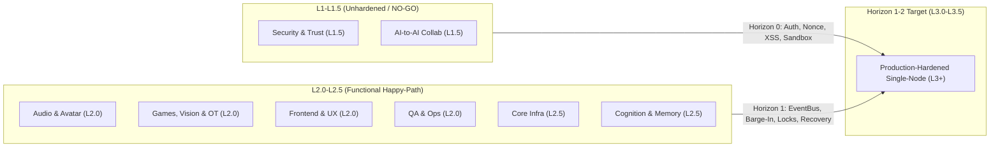

# MaybeAI — Current State Architecture & Maturity Assessment

**Document Owner:** Agent 11 (`strat-arch`) — Principal Software & Future Architecture Engineer  
**Evidence Basis:** `audit/FINAL_AUDIT_REPORT.md` and `audit/00`–`11` (Zero source modifications; verified against live code, 315 Python unit tests, Node.js guard tests, and Chaos Scenarios A–E).  
**Overall System Verdict:** **`NO-GO`** for Unattended / Public / Docker / LAN streaming; **`CONDITIONAL GO`** for Supervised Localhost Creator streaming (contingent on P0 concurrency/correctness fixes).

---

## 1. L0–L5 Maturity Scale Definition

To avoid optimistic grading, every subsystem is scored strictly against operational reality:

| Level | Label | Criteria |
|---|---|---|
| **L0** | **Absent / Stub** | Config key or interface exists, but runtime implementation is missing or dead. |
| **L1** | **Ad-Hoc / Prototype** | Works only in isolated happy paths; lacks error handling, bounds, or state persistence. |
| **L2** | **Functional Happy-Path** | Core feature works end-to-end under supervision, but has known concurrency races, security gaps, or missing recovery. |
| **L3** | **Production-Hardened Single-Node** | Authenticated, bounded, concurrency-safe, crash-recoverable, and verified under load/chaos on one host. |
| **L4** | **Resilient Autonomous Runtime** | Observable, self-healing across external adapter drops, token/resource-budgeted, and soak-tested for multi-hour streams. |
| **L5** | **Distributed Multi-Agent Platform** | Horizontally scalable, capability-negotiated multi-agent runtime with zero-trust isolation and automated CI/CD gates. |

---

## 2. Executive Maturity Scorecard

| Subsystem | Maturity | Deployment Readiness | Primary Limiting Factors (Audit IDs) |
|---|---|---|---|
| **1. Core Infrastructure** | **L2.5** | Conditional | Sequential `EventBus.publish()` HoL blocking (`[PERF-HIGH-001]`), 12+ untracked `create_task` leaks (`[INFRA-HIGH-001]`), `perform_song()` lock bypass (`[INFRA-HIGH-002]`), LLM key masking gap (`[INFRA-HIGH-005]`). |
| **2. Audio, Voice & Avatar** | **L2.0** | Conditional | Barge-in `CancelledError` swallowing (`[AUDIO-CRIT-001]`), synthetic 80 ms square-wave lip-sync colliding with browser RMS (`[AUDIO-CRIT-002]`), STT blocking WS loop (`[AUDIO-HIGH-001]`), `Singer` BGM not stopped (`[AUDIO-HIGH-002]`). |
| **3. Cognition & Memory** | **L2.5** | Conditional | Replanned goals never complete (`[COG-CRIT-001]`), infinite 25s replan loop (`[COG-CRIT-002]`), 0ms MC polling vs. fabricated offline progress (`[COG-HIGH-001]`), unbounded prompt (`[COG-HIGH-002]`), `is_creator` dropped (`[COG-HIGH-003]`). |
| **4. AI-to-AI Collab** | **L1.5** | **NO-GO** | Zero replay protection (`[COLLAB-CRIT-001]`), `_is_loopback_url` spoofing (`[COLLAB-HIGH-001]`), permanent cooldown deadlock (`[COLLAB-HIGH-003]`), concurrent reply storm (`[COLLAB-HIGH-004]`), partial sync wiring. |
| **5. Games, Vision & OT** | **L2.0** | Conditional | `chess.Board` thread race (`[GAME-CRIT-001]`), Mineflayer bridge no crash recovery & timer leaks (`[GAME-CRIT-002]`), OBS stale `is_connected=True` (`[GAME-HIGH-002]`), `ffmpeg` missing timeout/confinement (`[GAME-HIGH-004]`, `[SEC-HIGH-003]`). |
| **6. Security & Trust Boundaries** | **L1.5** | **NO-GO** | Unauthenticated `/ws` mutations & state push (`[SEC-CRIT-001]`), unjailed plugin sandbox (`[SEC-CRIT-002]`), broken Docker/LAN WS auth (`[SEC-HIGH-001]`), unauthenticated `GET /api/*` (`[SEC-HIGH-002]`), non-blocking `Moderator` (`[SEC-HIGH-004]`). |
| **7. Frontend & Creator UX** | **L2.0** | **NO-GO** (on `/settings`) | Stored DOM XSS in `/settings` (`[UI-HIGH-001]`), missing token UI & `401/403` crash on `/` & `/settings` (`[UI-HIGH-002]`), 2s WS reconnect storm & `deck.js` double-WS (`[UI-HIGH-003]`), CDN VRM dependency (`[UI-MED-004]`). |
| **8. QA, Testing & Ops** | **L2.0** | Conditional | 315 unit tests (1 load-sensitive error `[QA-HIGH-001]`), 0% live adapter/browser E2E coverage, tests mutate `data/` (`[QA-MED-003]`), 13+ asyncio slow-callback warnings (`>100ms`), no soak/CI gates. |

---

## 3. Subsystem-by-Subsystem Evidence & Capability Breakdown

### 3.1 Core Infrastructure (`run.py`, `core/orchestrator.py`, `core/event_bus.py`, `core/config_manager.py`, `core/chat_receiver.py`) — **Maturity: L2.5**
* **Current Capabilities:**
  * Typed async/sync pub-sub `EventBus` (`core/event_bus.py:124-264`) with wildcard `*`, per-handler exception isolation, and bounded `deque(maxlen=200)` history (verified in Chaos Scenario A and `test_event_bus.py`).
  * FastAPI `lifespan` startup/shutdown (`run.py:34-40`) orchestrating 16+ subsystems.
  * `ConfigManager` (`core/config_manager.py:248-255, 1582-1588`) with atomic `os.replace` saves and secret masking for 6 fields (`29` core infra tests passing in `1.729s`).
* **Partially Implemented:**
  * Hot-reload pipeline (`core/orchestrator.py:712-849`) spawns untracked `asyncio.create_task` calls (`[INFRA-HIGH-001]`: 12+ untracked call sites across `orchestrator.py` and `run.py:631`).
  * `perform_song()` bypasses `_busy_lock` when invoked via `POST /api/performance/start` or `AutonomousMissionExecutor` (`[INFRA-HIGH-002]`).
  * `EventBus.publish()` awaits handlers sequentially, causing head-of-line blocking (`0.207s` stall on a `200ms` subscriber in Chaos Scenario A1, `[PERF-HIGH-001]` / `[INFRA-HIGH-003]`).
  * `ConfigManager.validate_config()` only validates 110 schema keys out of `DEFAULT_SETTINGS`, uses a fixed `.tmp` filename, and omits `llm.gemini_api_key` / `llm.openai_api_key` from `SECRET_MASK_FIELDS` (`[INFRA-HIGH-005]`, `[INFRA-MED-001]`).
  * `ChatReceiver.queue` is unbounded (`asyncio.Queue()`), and `ChatMessage` uses deprecated `asyncio.get_event_loop().time()` (`[INFRA-HIGH-004]`).
* **Planned Capabilities:**
  * Runtime enforcement of `performance.max_concurrent_tasks`, `performance.websocket_ping_interval_sec`, and `system.response_timeout_sec` (defined in `DEFAULT_SETTINGS` with 0 runtime references, `[INFRA-MED-002]`).
  * Offloading synchronous `ConfigManager` / SQLite / `VODSummarizer` disk I/O off the event loop (`[INFRA-MED-003]`).

### 3.2 Real-Time Audio, Voice Duplex & Avatar Synchronization (`core/tts.py`, `core/tts_providers.py`, `core/stt.py`, `core/singer.py`, `core/vts_client.py`) — **Maturity: L2.0**
* **Current Capabilities:**
  * Browser 16 kHz mono Int16 PCM capture via `AudioWorklet` (`web/audio-worklet-processor.js`, 32 ms frames) with `EnergyVAD` (`core/stt.py:23-118`) and `StreamingSTTSession` (30s max buffer).
  * Streaming LLM -> `SentenceChunker` (`core/tts.py:20-135`) -> `TTSEngine.speak_stream()` bounded `asyncio.Queue(maxsize=4)` with clean temp-file cleanup on barge-in (verified in Chaos Scenario B: `0` disk leftovers).
* **Partially Implemented:**
  * **Full-Duplex Barge-In:** `TTSEngine.speak_stream()` catches `asyncio.CancelledError` and returns partial text instead of re-raising when `_stop_requested=True` (`[AUDIO-CRIT-001]`, `core/tts.py:588-600`), letting `Orchestrator._execute_interaction()` emit post-barge-in `ai_response` / Minecraft / Discord messages. Barge-in also fails to stop `Singer` BGM (`pygame.mixer.music`, `[AUDIO-HIGH-002]`), and `transcribe_wav_bytes()` blocks the WS receive loop (`[AUDIO-HIGH-001]`).
  * **Multi-Provider TTS & RVC:** `EdgeTTSProvider` fallback uses incompatible non-Edge `self.voice` (`[AUDIO-HIGH-003]`), MIME/filename is hardcoded to `audio/mpeg` / `input.mp3` even for WAV from Kokoro, and `Singer` bypasses `create_tts_provider()`.
  * **VTube Studio Integration:** Authenticates and injects parameters, but `VTS_AUTH_TOKEN` is ephemeral and `auto_reconnect: true` has no reconnect loop.
* **Planned Capabilities:**
  * **Server-Side Audio-Envelope Lip-Sync:** Currently a synthetic 80 ms square wave (`0.95`/`0.50` in `TTSEngine`, `0.70`/`0.20` in `Singer`) that collides with browser `AnalyserNode` RMS in `output_mode="both"` (`[AUDIO-CRIT-002]`).
  * **Streaming Partial STT:** `stt_partial` only broadcasts static `"Listening..."` (`[AUDIO-LOW-001]`).

### 3.3 Cognition, Memory & Autonomous Planning (`core/brain.py`, `core/conversation/`, `core/memory/`, `core/mood/`, `core/personality/`, `core/relationship/`, `core/planning/`) — **Maturity: L2.5**
* **Current Capabilities:**
  * Multi-provider LLM routing (`openai`, `gemini`, `ollama`, `mock`) with SSE/NDJSON streaming and shared `aiohttp.ClientSession` reuse (`core/brain.py`).
  * Hybrid Second Brain memory (`core/memory/`): SQLite FTS5 + dense cosine vector search + Karpathy Markdown sync.
  * 5-dimension `MoodEngine` with exponential decay, bounded `PersonalityEvolutionEngine` (`[0.05, 0.98]`), and 5-tier `RelationshipEngine` (79 cognitive unit tests passing in `2.537s`).
* **Partially Implemented:**
  * **Closed-Loop Autonomous Missions (`AutonomousMissionExecutor`):** Replanned goals can **never** reach `COMPLETED` because `Goal.recalculate_progress()` includes `REPLANNED` subtasks in the denominator (`[COG-CRIT-001]`). Repeated failures trigger an infinite 25s replan loop growing `goals.json`/`agenda.md` unboundedly (`[COG-CRIT-002]`). Live Minecraft telemetry checks inventory 0ms after `toggle_wander()`, while disconnected mode fabricates `simulated: True` progress (`[COG-HIGH-001]`). Approval gates have no timeout (`[COG-MED-001]`).
  * **Identity & Routing:** `is_creator` is dropped on all live LLM paths and error fallbacks (`[COG-HIGH-003]`). `MoodEngine.get_temperature_modifier()` is implemented but never called by `Brain`.
  * **Memory Performance:** `EpisodicMemoryStore` instantiates a duplicate `EmbeddingEngine` (`[COG-HIGH-004]`), `_encode_gemini_async()` creates a new `aiohttp.ClientSession` per call (`[PERF-MED-001]`), and vector search is capped at 300 rows (`[COG-HIGH-005]`).
* **Planned Capabilities:**
  * **Context Window Budgeter:** `MasterPromptBuilder` concatenates 11+ subsystem directives unconditionally with mismatched `max_tokens` (`150` OpenAI vs `800` Gemini, `[COG-HIGH-002]`).
  * **Cross-Provider LLM Failover & Bidirectional Markdown Sync:** Provider errors drop straight to offline mock responses; `fulfill_promise()` is never wired.

### 3.4 AI-to-AI Collaboration (`core/collab/protocol.py`, `core/collab/manager.py`, `run.py`) — **Maturity: L1.5**
* **Current Capabilities:**
  * `CollabEnvelope` canonical JSON + HMAC-SHA256 signing/verification (`core/collab/protocol.py:55-106`), `/ws/collab` transport, and `shared_secret` masking (`9/9` unit tests passing).
* **Partially Implemented:**
  * **Security & Replay:** Zero replay protection (`message_id` nonce cache and `timestamp` freshness window are missing, reproduced in Chaos Scenario D3, `[COLLAB-CRIT-001]`). `_is_loopback_url()` uses substring matching (`ws://localhost.evil.com` returns `True`, `[COLLAB-HIGH-001]`). `/ws/collab` accepts query-string secrets and mutates global `shared_secret` (`[COLLAB-HIGH-002]`).
  * **Floor & Turn Arbitration:** `turn_cooldown_sec` permanently deadlocks in `"cooldown"` once `turn_count >= max_collab_turns` because `_refresh_cooldown()` checks `turn_count < max_collab_turns` (`[COLLAB-HIGH-003]`). Inbound `turn_utterance` bursts spawn concurrent LLM reply tasks (`[COLLAB-HIGH-004]`), and `emote_sync`/`duet_sync` bypass cooldown (`[QA-MED-002]`).
  * **Subsystem Sync:** `duet_sync`, `emote_sync`, and `game_move` are inbound-only and ignore sync parameters (`lyric_index`, `timestamp`, `action`).
* **Planned Capabilities:**
  * Replay/nonce cache, `collab.enabled=False` enforcement (`[COLLAB-MED-001]`), capability handshake, and Web Dashboard Collab UI.

### 3.5 Games, Vision, OBS & Highlights (`core/minecraft/`, `core/chess/`, `core/vision/`, `core/desktop/`, `core/highlights/`, `minecraft/bot.js`) — **Maturity: L2.0**
* **Current Capabilities:**
  * `ChessController`/`ChessEngine` (`python-chess`, alpha-beta depths 1–4), `MiniGameEngine` (6 modes), `StoryEngine` (campaigns + D20), `VisionEngine` (`mss` + pixel diff + rate-limited VLM), `PerformanceDirector`, `OBSWebSocketClient`, `HighlightDetector`, `ClipPipeline` (`ffmpeg` 9:16), and `VODSummarizer`.
* **Partially Implemented:**
  * **Chess:** `amake_bot_move()` mutates shared `self.engine.board` inside `asyncio.to_thread` without cloning or locking (`[GAME-CRIT-001]`).
  * **Minecraft Bridge:** `MinecraftController` has no Node.js crash recovery, leaves `connection_status="connected"` on drop (Chaos Scenario E1, `[GAME-CRIT-002]` / `[QA-HIGH-002]`), and `bot.js` leaks `setInterval` timers while swallowing `uncaughtException`.
  * **OBS & Highlights:** `OBSWebSocketClient` leaves `is_connected=True` on transport error (Chaos Scenario E2, `[GAME-HIGH-002]`), `HighlightDetector` sets `replay_saved=True` before async OBS save finishes (`[GAME-HIGH-003]`), `ClipPipeline` lacks path confinement (`[SEC-HIGH-003]`), `-nostdin`, and `ffmpeg` timeout (`[GAME-HIGH-004]`), and `VisualAnalyzer` raises `TypeError` on `detected_label` (`[GAME-HIGH-001]`).
  * **Karaoke:** `Singer` suffers cumulative TTS network drift and runs blocking `pygame` calls on the event loop (`[GAME-HIGH-005]`).
* **Planned Capabilities:**
  * Live VLM-grounded commentary, OBS auto-reconnect, and audio-clock-locked karaoke.

### 3.6 Security & Operational Technology (`run.py`, `core/plugins/`, `core/moderator.py`, `core/desktop/`) — **Maturity: L1.5**
* **Current Capabilities:**
  * Origin validation + constant-time token comparison on mutating HTTP endpoints, parameterized SQLite/FTS5 queries, Desktop Companion metacharacter filtering (`shell=False`), and clean plugin subprocess `env` stripping (`leaks=[]` in Chaos Scenario C2).
* **Partially Implemented:**
  * **WebSocket & HTTP Auth:** `_CREATOR_ONLY_WS_ACTIONS` omits `memory_action`, `mood_action`, `relationship_action`, `minigame_action`, `story_action`, `multiplayer_action`, and `trigger_improv`, while `/ws` pushes private state pre-auth (`[SEC-CRIT-001]`). `_is_ws_creator_authorized()` checks loopback *before* token, breaking Docker/LAN Creator auth (`[SEC-HIGH-001]`). All `GET /api/*` routes except `/api/config` are unauthenticated (`[SEC-HIGH-002]`).
  * **Plugin Sandbox:** No OS filesystem/network/RLIMIT jail (plugins can read `.env`, `config/settings.json`, `data/memory.db`), trusts self-declared `manifest.permissions`, executes import-time code, and permits `inprocess` mode (`[SEC-CRIT-002]`).
  * **Prompt Injection & Moderation:** `Moderator.clean_text()` only redacts with `[CENSORED]` and never drops messages; `strict_mode` and `prompt_injection_filter` are dead flags; `user`/`donation_amount` are unmoderated (`[SEC-HIGH-004]`).
* **Planned Capabilities:**
  * OS-level plugin sandboxing, persistent `VTS_AUTH_TOKEN`, `ANTHROPIC_API_KEY` / `GROQ_API_KEY` routing, and fail-closed Docker/LAN token generation.

### 3.7 Frontend & Creator UX (`web/`) — **Maturity: L2.0**
* **Current Capabilities:**
  * 4-tab Studio Dashboard (`/`), OBS Stage Overlay (`/overlay`), Mobile Stream Deck (`/deck` with `#deck-auth-bar`), 23-category Settings Center (`/settings`), and `AudioWorklet` 16 kHz downsampler.
* **Partially Implemented:**
  * **Security & Auth UX:** `/settings` has stored DOM XSS across `renderDiagnosticsView()`, `renderCategorySettingsView()`, `renderSearchResults()`, and `renderControlHtml()` (`[UI-HIGH-001]`). `/` and `/settings` lack token entry UI and crash on `401/403` (`[UI-HIGH-002]`).
  * **Transport & Audio:** Uncapped 2000ms WS reconnect loop across all pages, missing `overlay.js` `ws.onopen` re-sync, `deck.js` double-WS race on token save (`[UI-HIGH-003]`), and `AudioWorklet` resampler/tail-frame drop (`[UI-MED-002]`).
* **Planned Capabilities:**
  * Shared `CreatorAuth` + `ReconnectingWebSocket` client, local vendoring of Three.js/`@pixiv/three-vrm`/fonts (`[UI-MED-004]`), binary WS PCM frames, and live `/settings` status badge.

### 3.8 QA, Testing & Operations (`tests/`, `Dockerfile`, `docker-compose.yml`) — **Maturity: L2.0**
* **Current Capabilities:**
  * 35 Python test files (`315` tests) + `1` Node.js test (`test_guard_runner.js`) + `node --check` on all 5 JS files. Zero `DeprecationWarning` / `ResourceWarning` tracebacks under `-W default`.
* **Partially Implemented:**
  * Full suite had 1 load-sensitive error (`test_hard_timeout_kills_infinite_loop_subprocess` due to shared `hook_timeout_sec` on cold start, `[QA-HIGH-001]`).
  * Tests mutate workspace `data/` files (`[QA-MED-003]`), and `PluginRegistry._subprocesses` retains crashed worker entries (`[QA-MED-001]`).
* **Planned Capabilities:**
  * Live integration contract tests (OBS, VTS, Mineflayer, `ffmpeg`), browser E2E tests, multi-hour soak tests, and CI/CD quality gates.
