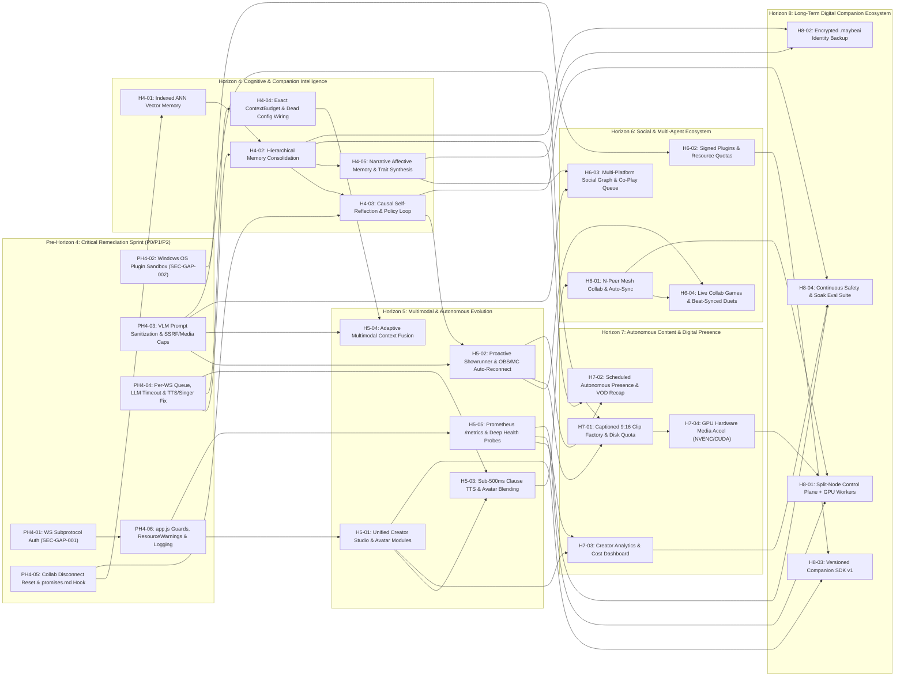

# MaybeAI — Dependency Graph & Critical Path (`strategy/DEPENDENCY_GRAPH.md`)

**Owner:** AGENT 12 (`ng-strat-roadmap` — CTO Strategy & Roadmap Manager)  
**Baseline Grounding:** [FINAL_POST_IMPLEMENTATION_AUDIT.md](file:///d:/projects/MaybeAI/audit/FINAL_POST_IMPLEMENTATION_AUDIT.md) (`HEAD` `96b7315`) & [DEVELOPMENT_ROADMAP.md](file:///d:/projects/MaybeAI/strategy/DEVELOPMENT_ROADMAP.md)

---

## 1. Cross-Horizon Dependency Graph (Pre-H4 through Horizon 8)

> [!IMPORTANT]
> **Horizons 0–3 are already complete** (`4c4e473`..`96b7315`). The graph below starts at the **Pre-Horizon 4 Remediation Sprint (`PH4-01..PH4-06`)** and maps all hard technical, security, and architectural dependencies through **Horizon 8 (`H8-01..H8-04`)**.

---

## 2. Critical Path Analysis

The **Critical Path** is the longest sequential chain of dependent work packages from **Pre-Horizon 4** to **Horizon 8 (`L5 Platform`)**. Any slip on these nodes directly delays final platform completion:

| Step | Work Package | PERT Expected ($E$) | Rationale on Critical Path |
|---|---|---:|---|
| 1 | **`PH4-04`** (Per-WS Queue, LLM Timeout & TTS/Singer Fix) | **2.1 d** | Unblocks reliable streaming LLM calls required by memory consolidation (`H4-02`) and clause TTS (`H5-03`). |
| 2 | **`H4-02`** (Hierarchical Memory Consolidation) | **5.3 d** | Depends on `PH4-04` (and `H4-01` ANN index); foundational for causal reflection (`H4-03`). |
| 3 | **`H4-03`** (Causal Self-Reflection & Policy Loop) | **4.7 d** | Depends on `H4-02`; required before enabling autonomous showrunner (`H5-02`). |
| 4 | **`H5-02`** (Proactive Showrunner & OBS/MC Auto-Reconnect) | **5.2 d** | Depends on `H4-03`; unlocks automated clip factory (`H7-01`) and live collab games (`H6-04`). |
| 5 | **`H7-01`** (Captioned 9:16 Clip Factory & Disk Quota) | **6.2 d** | Depends on `H5-02`; feeds GPU hardware media acceleration (`H7-04`). |
| 6 | **`H7-04`** (GPU Hardware Media Accel) | **3.9 d** | Depends on `H7-01`; establishes worker offload interfaces needed for `H8-01`. |
| 7 | **`H8-01`** (Split-Node Control Plane + GPU Workers) | **9.8 d** | Longest single package in H8; depends on `H7-04`, `H6-01`, and `H5-05`. |

- **Critical Path Sequential Sum:** $2.1 + 5.3 + 4.7 + 5.2 + 6.2 + 3.9 + 9.8 = \mathbf{37.2\text{ person-days}}$ (plus gate soak/verification buffers).
- **Parallelizable Secondary Paths:**
  - **Security & Ecosystem Track:** `PH4-02` (2.6d) $\rightarrow$ `H6-02` (6.2d) $\rightarrow$ `H8-03` (7.7d) = **16.5 person-days** (runs in parallel with H4–H7).
  - **Frontend & Analytics Track:** `PH4-01` (1.6d) $\rightarrow$ `PH4-06` (4.0d) $\rightarrow$ `H5-01` (6.8d) $\rightarrow$ `H7-03` (5.2d) $\rightarrow$ `H8-04` (5.7d) = **23.3 person-days** (runs in parallel with Cognitive/Media).

---

## 3. Hard Gate Rules Across Horizons

1. **No H4+ Expansion Before Pre-H4 P0s (`PH4-01`, `PH4-02`, `PH4-03`):** Unattended 24/7 or LAN deployments remain blocked until WS subprotocol auth, Windows OS plugin isolation, and VLM prompt sanitization pass regression tests.
2. **No Autonomous Showrunner (`H5-02`) Before Causal Reflection (`H4-03`):** Prevents Eve from repeating failed autonomous strategies in unattended loops.
3. **No Outbound Scheduled Posting (`H7-02`) Without Approval Queue:** Creator approval gate is mandatory by default to prevent unmoderated social posting.
