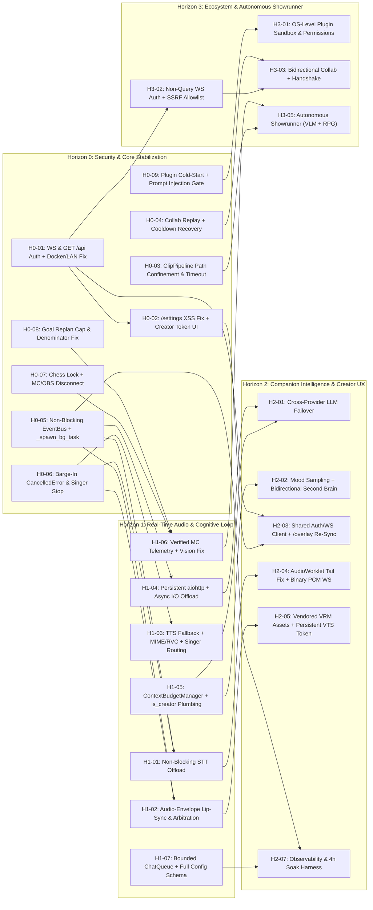

# MaybeAI — Cross-Subsystem Dependency Map & Critical Path (`strategy/DEPENDENCY_MAP.md`)

**Owner:** AGENT 12 (`strat-roadmap` — Strategic Development & Roadmap Manager)  
**Baseline Grounding:** [FINAL_AUDIT_REPORT.md](file:///d:/projects/MaybeAI/audit/FINAL_AUDIT_REPORT.md) and `audit/01..11`.

---

## 1. Cross-Subsystem Dependency Graph

The graph below models hard technical and security prerequisites across Horizons 0–3. **Downstream nodes cannot safely ship until all upstream blockers are resolved.**

---

## 2. Critical Path Analysis

The **Critical Path** is the longest chain of dependent work packages determining the minimum calendar duration to reach a full production Autonomous Showrunner:

1. **`H0-05` (`EventBus` Non-Blocking & Task Tracking, $E = 2.6\text{d}$)** — Unblocks all real-time concurrent pipelines without head-of-line stalls.
2. **`H0-06` (Barge-In `CancelledError` & `Singer` Stop, $E = 1.6\text{d}$)** — Must stabilize interruption semantics before modifying STT/TTS pipelines.
3. **`H1-02` (Audio-Envelope Lip-Sync & Browser Arbitration, $E = 3.1\text{d}$)** — Depends on `H0-05` + `H0-06`.
4. **`H1-05` (`ContextBudgetManager` & `is_creator` Plumbing, $E = 3.1\text{d}$)** — Runs parallel to `H1-02` on the cognitive track; critical for LLM failover.
5. **`H2-01` / `H2-02` (LLM Failover & Bidirectional Second Brain, $E = 5.7\text{d}$ combined)** — Depends on `H1-04` + `H1-05`.
6. **`H2-07` (Observability & 4h Soak Harness, $E = 4.2\text{d}$)** — Validates stability of H0–H2 before H3 expansion.
7. **`H3-01` (OS-Level Plugin Sandbox, $E = 6.2\text{d}$)** or **`H3-05` (Autonomous Showrunner, $E = 5.3\text{d}$)** — Final Horizon 3 gate.

- **Critical Path Duration (Sequential Sum):** $2.6 + 1.6 + 3.1 + 3.1 + 4.2 + 6.2 = \mathbf{20.8\text{ person-days}}$ (plus integration/verification buffers $\rightarrow$ **10–14 weeks** calendar across all 4 horizons with 2 streams).

---

## 3. Mandatory Blocker Resolution Order (Gate Rules)

| Precedence | Blocker | Why It Must Come First | What Remains Blocked Until Resolved |
|---|---|---|---|
| **1** | **`H0-01` + `H0-02`** (`[SEC-CRIT-001]`, `[SEC-HIGH-001/002]`, `[UI-HIGH-001/002]`) | Unauthenticated `/ws` mutations, `/api/*` leaks, broken Docker/LAN WS auth, and `/settings` XSS allow full takeover of config, tokens, and memory. | Docker `--host 0.0.0.0`, LAN streaming, `/settings` remote usage, shared frontend auth module (`H2-03`). |
| **2** | **`H0-05` + `H0-06`** (`[PERF-HIGH-001]`, `[INFRA-HIGH-001/002]`, `[AUDIO-CRIT-001]`) | Sequential `EventBus.publish()` and swallowed `CancelledError` cause global pipeline stalls and post-barge-in leaks. | Non-blocking STT (`H1-01`), audio-envelope lip-sync (`H1-02`), soak testing (`H2-07`). |
| **3** | **`H0-07` + `H0-08`** (`[GAME-CRIT-001/002]`, `[COG-CRIT-001/002]`) | Infinite 25s replan loops and stale `connected` states corrupt `goals.json` and spam TTS/MoodEngine. | Verified Minecraft telemetry (`H1-06`), Autonomous Showrunner (`H3-05`). |
| **4** | **`H0-04`** (`[COLLAB-CRIT-001]`, `[COLLAB-HIGH-001/003/004]`) | Replay vulnerability, URL substring spoof, and permanent `"cooldown"` deadlock break multi-AI collab. | Bidirectional `duet_sync`/`emote_sync`/`game_move` (`H3-03`), Collab Dashboard UI (`H2-06`). |
| **5** | **`H0-09`** (`[SEC-CRIT-002]` triage, `[SEC-HIGH-004]`) | Prompt injection reaches LLM unblocked; third-party plugins have host filesystem/network access. | Public chat-driven autonomous agency (`H3-05`), untrusted third-party plugin marketplace (`H3-01`). |
