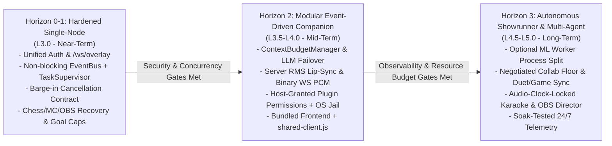
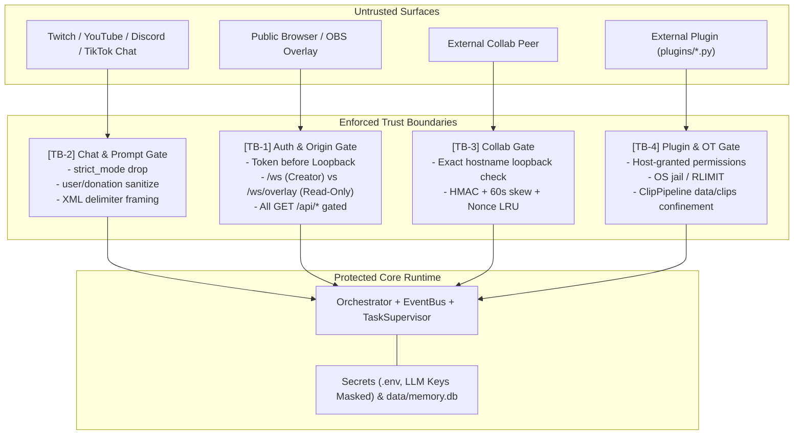
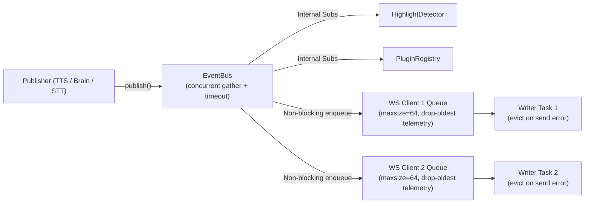
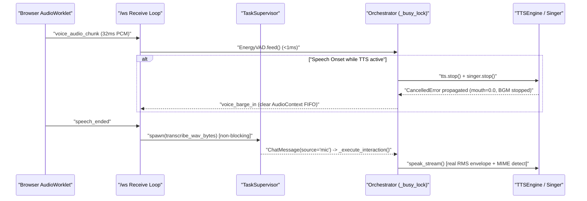

# MaybeAI — Future State Architecture

**Document Owner:** Agent 11 (`strat-arch`) — Principal Software & Future Architecture Engineer  
**Design Principle:** Evolutionary hardening over full-system rewrite. Preserve MaybeAI's working strengths (typed `EventBus`, streaming `SentenceChunker`-to-TTS pipeline, hybrid SQLite+Markdown Second Brain, `python-chess`/Mineflayer/OBS/VTS integrations) while eliminating concurrency stalls, trust-boundary gaps, and state-machine deadlocks.

---

## 1. Three-Horizon Architecture Evolution

---

## 2. Near-Term Target (Horizon 0–1): Hardened Trust Boundaries & Non-Blocking Core

### 2.1 Unified Auth & Trust Boundary Architecture
Fixes `[SEC-CRIT-001]`, `[SEC-HIGH-001]`, `[SEC-HIGH-002]`, `[SEC-HIGH-003]`, `[SEC-HIGH-004]`, `[SEC-HIGH-005]`, and `[UI-HIGH-001]`/`[UI-HIGH-002]`:
* **Fail-Closed Creator Auth:** `_is_ws_creator_authorized()` and `_is_http_creator_authorized()` share a single `_verify_creator_request()` helper that checks `MAYBEAI_CREATOR_TOKEN` (via `Authorization: Bearer` header or subprotocol/first-frame auth, deprecating `?token=` query params) **before** checking `_LOOPBACK_HOSTS`. Binding `--host 0.0.0.0` without a configured token auto-generates an ephemeral startup token.
* **Split Public Overlay vs. Creator Control Plane:**
  * `/ws/overlay` (read-only public stream telemetry: `ai_response`, `audio_chunk`, `avatar_state`, `performance_updated`, `minigame_updated`, `story_updated`).
  * `/ws` (authenticated Creator control plane: all mutating/private actions + initial private snapshots `memory_updated`, `goal_updated`, `desktop_updated`, `system_diagnostics`).
* **HTTP `GET /api/*` Protection:** Every `/api/*` endpoint except `/api/health` requires `_is_http_creator_authorized()`.
* **Input & OT Confinement:** `Moderator` enforces `strict_mode` / `prompt_injection_filter` (dropping flagged chat, capping/sanitizing `user` and `donation_amount`), and `ClipPipeline` confines all paths to `data/clips` via `Path.resolve().is_relative_to()`.

### 2.2 Non-Blocking `EventBus`, Per-Client WS Queues & `TaskSupervisor`
Fixes `[PERF-HIGH-001]`, `[INFRA-HIGH-001]`, `[INFRA-HIGH-002]`, `[INFRA-HIGH-003]`, `[INFRA-HIGH-004]`, `[INFRA-MED-003]`:
* **`EventBus.publish()`:** Dispatches subscribers concurrently via `asyncio.gather(*coros, return_exceptions=True)` with a bounded per-subscriber timeout (`subscriber_timeout_sec`, e.g., `2.0s`) so a stalled listener never blocks `TTSEngine`, `VTSClient`, or other subscribers. `publish_nowait()` routes through a bounded `TaskSupervisor` semaphore.
* **Per-WS Bounded Send Queues:** Each `/ws` and `/ws/overlay` connection owns an `asyncio.Queue(maxsize=64)` drained by a dedicated writer task. High-frequency telemetry (`avatar_state`, `stt_partial`) uses drop-oldest overflow policy; control/chat frames use bounded wait + dead-socket eviction.
* **Centralized `TaskSupervisor`:** Replaces all 14 raw `asyncio.create_task()` calls in `core/orchestrator.py` and `run.py` with `supervisor.spawn(name, coro)`, ensuring exception logging, graceful cancellation on `shutdown()`, and explicit `_busy_lock` protection on `perform_song()`.

---

## 3. Mid-Term Target (Horizon 2): Modular Event-Driven Companion

### 3.1 Turn, Audio & Barge-In Arbitration State Machine
Fixes `[AUDIO-CRIT-001]`, `[AUDIO-CRIT-002]`, `[AUDIO-HIGH-001]`, `[AUDIO-HIGH-002]`, `[AUDIO-HIGH-003]`:
* **Single-Owner Speech Arbitration:** `_busy_lock` protects all speech/singing/improv/mission-commentary flows.
* **Strict `CancelledError` Contract:** `TTSEngine.speak_stream()` and `Singer.sing()` **always** re-raise `asyncio.CancelledError` on interruption after resetting `mouth_open: 0.0`, stopping `pygame.mixer.music`, and deleting temp files. `Orchestrator._execute_interaction()` never emits `ai_response`, Minecraft chat, or Discord messages if interrupted.
* **Non-Blocking STT Offload:** `process_voice_chunk()` runs `EnergyVAD` synchronously in <1ms and spawns `transcribe_wav_bytes()` on `TaskSupervisor` so `/ws` `barge_in` frames are never blocked by Whisper API/local inference.
* **Unified Lip-Sync Authority:** Server computes real PCM/RMS amplitude envelopes from synthesized audio frames; browser `AnalyserNode` remains authoritative when playing `audio_chunk` in `browser`/`both` modes, ignoring conflicting `avatar_state.mouth_open` while `isPlayingAudioQueue` is active.

### 3.2 Cognitive Budgeter, Failover & Closed-Loop Mission Architecture
Fixes `[COG-CRIT-001]`, `[COG-CRIT-002]`, `[COG-HIGH-001]`, `[COG-HIGH-002]`, `[COG-HIGH-003]`:
* **`ContextBudgetManager`:** Estimates token counts per prompt section, prunes inactive subsystem directives (`minigame`, `storytelling`, `desktop` when idle), harmonizes `max_tokens` across OpenAI/Gemini/Ollama, and injects `[CREATOR VERIFIED]` when `is_creator=True`.
* **LLM Failover Chain:** `Primary Provider -> Secondary Configured Provider -> Local Ollama -> Offline Mock` with per-provider circuit breaker (`failure_threshold=3`, `cooldown=30s`), always preserving `is_creator`.
* **Closed-Loop Mission Supervisor:**
  * `Goal.recalculate_progress()` excludes `REPLANNED` subtasks from the completion denominator.
  * `MAX_REPLAN_ATTEMPTS = 3` transitions exhausted goals to `FAILED` and pivots via `autonomous_select_next_activity()`.
  * Disconnected adapters never fabricate real progress unless `allow_simulated_progress=True`; live Minecraft missions evaluate inventory/position deltas asynchronously via `mc_telemetry` events across ticks instead of 0ms inline polling.
  * `pending_approval` expires after `approval_timeout_sec` (default `120s`).

### 3.3 External Adapter & Game Engine Resilience
Fixes `[GAME-CRIT-001]`, `[GAME-CRIT-002]`, `[GAME-HIGH-002]`, `[GAME-HIGH-003]`, `[GAME-HIGH-004]`:
* **Chess:** `ChessEngine.choose_move()` operates on `self.board.copy(stack=False)` inside `asyncio.to_thread`, guarded by an `asyncio.Lock` that cancels pending `_delayed_bot_move` tasks on `start_game()`/`resign_game()`.
* **Minecraft & OBS:** Both `MinecraftController` and `OBSWebSocketClient` reset connection state (`is_connected=False`, `connection_status="disconnected"`) in `finally:` / error handlers and run bounded exponential-backoff reconnect loops; `bot.js` clears `setInterval` timers on disconnect and exits on `EADDRINUSE`.
* **Highlights:** `HighlightDetector` updates `marker.replay_saved` only upon async task completion; `ClipPipeline` passes `-nostdin` and enforces `asyncio.wait_for(..., timeout=120.0)` with partial-file cleanup.

---

## 4. Long-Term Target (Horizon 3): Autonomous Showrunner & Multi-Agent Runtime

* **Optional Worker-Process Split for Heavy ML:** Isolate `faster-whisper`, `kokoro-onnx`, `sentence-transformers`, and VLM inference behind a lightweight local worker protocol (Unix socket / stdio / local HTTP) when GPU/VRAM or multi-stream scaling requires it, while keeping single-process `asyncio` as the zero-config default.
* **Hardened Multi-Agent Collab (`CollabManager`):**
  * Replay-protected `CollabEnvelope` (60s timestamp skew + bounded `(sender_id, message_id)` nonce LRU).
  * Deterministic floor state machine (`idle` -> `thinking` -> `speaking` -> `yielding` -> `cooldown` -> auto-reset `turn_count=0` on cooldown expiry).
  * Capability negotiation in `hello` + bidirectional `duet_sync` (lyric index + audio-clock timestamp), `emote_sync`, and `game_move`.
* **Audio-Clock-Locked Karaoke & Showrunner:** Pre-synthesize upcoming lyric lines and lock lyric/choreography/OBS scene cues to `pygame.mixer.music.get_pos()` / browser `AudioContext.currentTime`.
* **Local-First Frontend & Binary Audio:** Bundle Three.js, `@pixiv/three-vrm`, and fonts locally in `web/vendor/`, extract `web/shared-client.js` (`CreatorAuth` + exponential-backoff `ReconnectingWebSocket`), and switch `AudioWorklet` PCM streaming from JSON+base64 to binary WebSocket frames.
