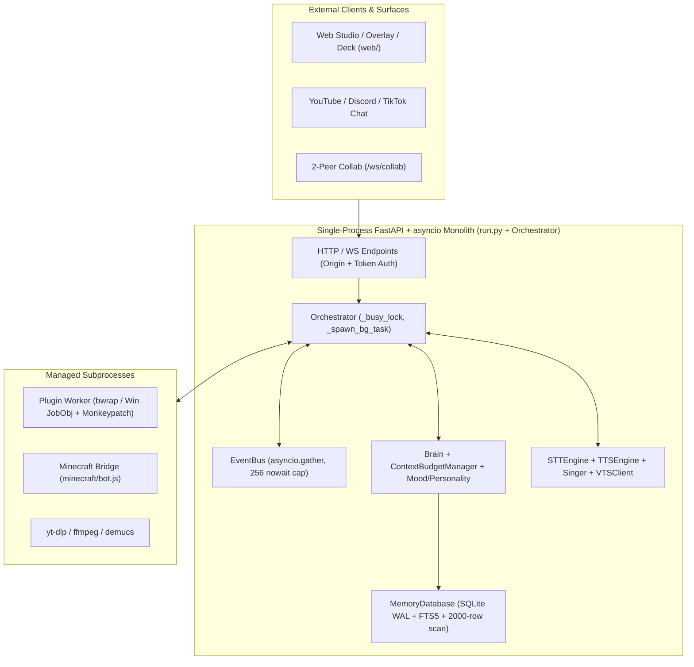
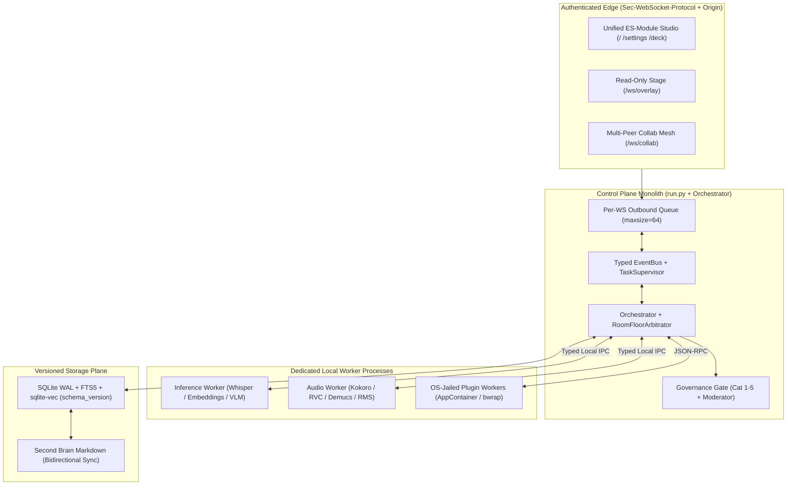
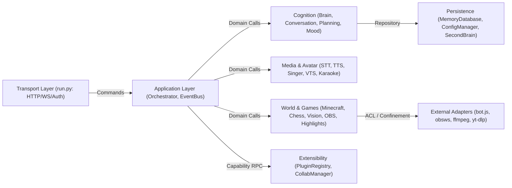
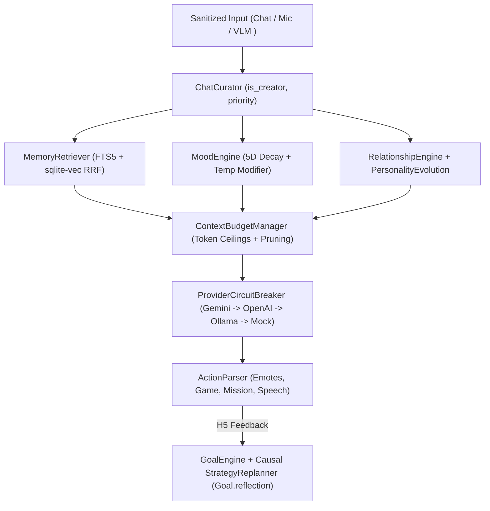
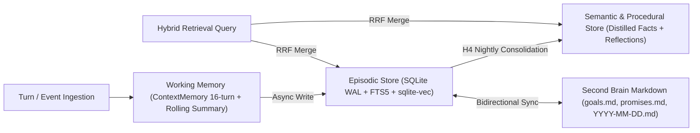
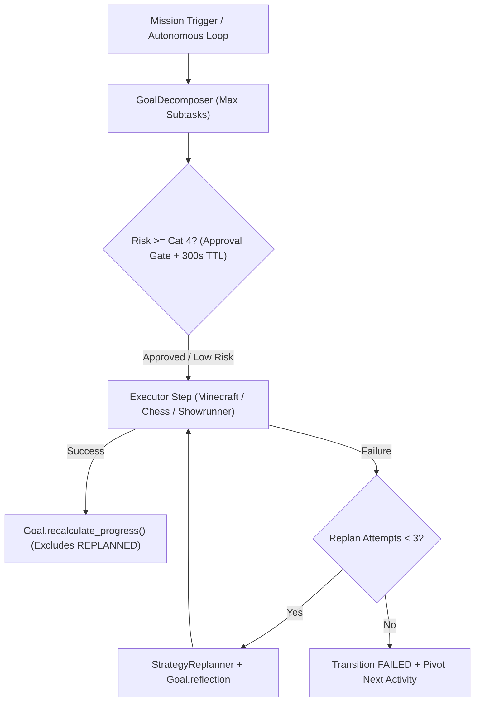
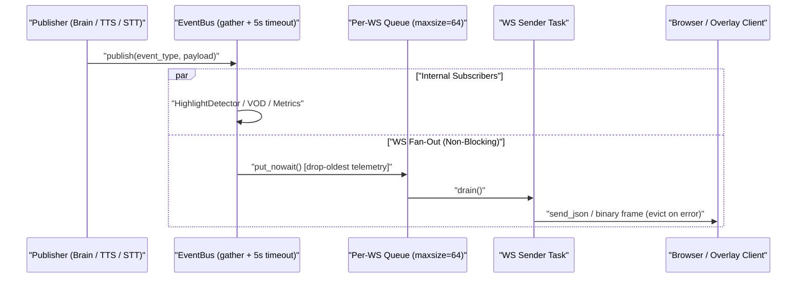
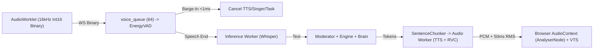
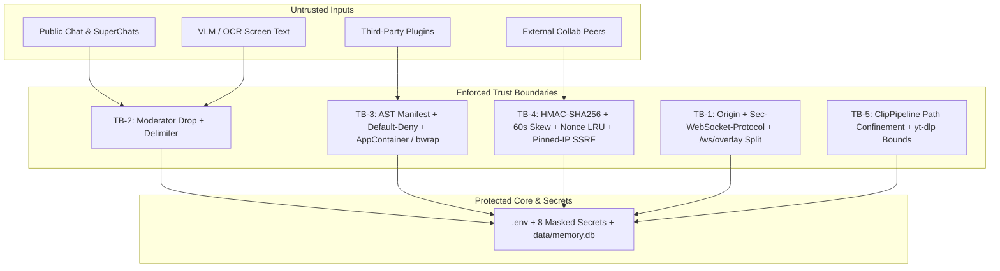
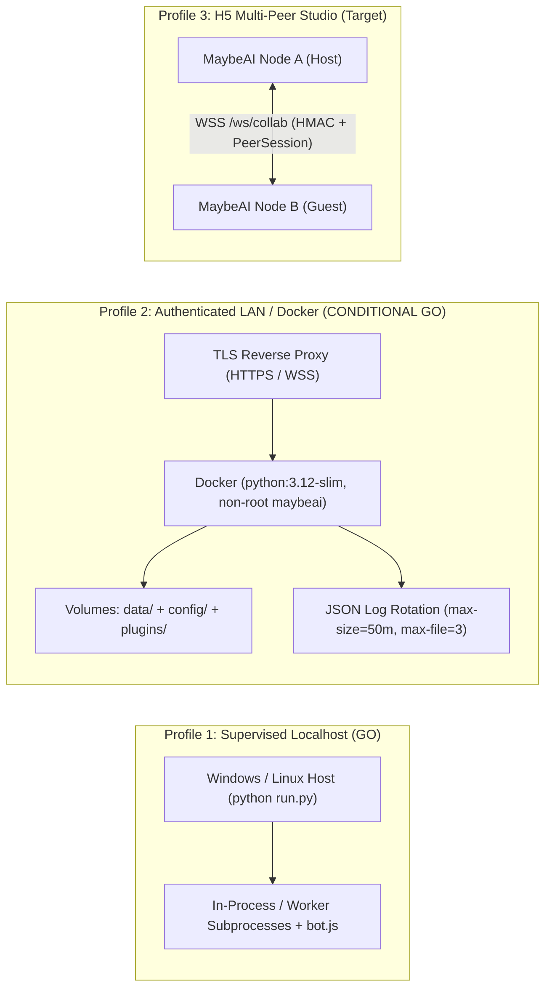

# MaybeAI — Future State Architecture & Governance (`strategy/FUTURE_STATE_ARCHITECTURE.md`)

**Document Owner:** Agent 11 (`ng-strat-arch`) — Principal Software & Future Architecture Engineer  
**Target Baseline:** `HEAD` commit `96b7315` (Post-Horizon 0–3 + YouTube Karaoke, L3.0–L3.5)  
**Design Principle:** Evolutionary **Modular Monolith + Multi-Process Inference/Audio Workers + Event-Driven** progression. Preserve MaybeAI's verified strengths (`EventBus`, `ProviderCircuitBreaker`, `ContextBudgetManager`, `AudioWorklet` binary PCM, SQLite WAL + FTS5 + Second Brain, OS-isolated plugins) while eliminating Pre-H4 blockers and scaling cleanly to H4/H5 without premature microservices or full rewrites.

---

## §11. Three-Horizon Target Architecture

### §11.1 Near-Term Target (Pre-Horizon 4 / Hardening Sprint — L3.5 → L4.0)

Eliminates all P0–P2 blockers from [FINAL_POST_IMPLEMENTATION_AUDIT.md](file:///d:/projects/MaybeAI/audit/FINAL_POST_IMPLEMENTATION_AUDIT.md) to unlock `GO` for Unattended 24/7 and Authenticated LAN/Docker:

- **Security & Trust (`SEC-GAP-001`..`005`):**
  - Switch `web/shared-client.js` WS auth to `Sec-WebSocket-Protocol: maybeai.token.<token>`, remove `?token=` from `buildWsUrl()`, and move token persistence from `localStorage` to `sessionStorage`/`HttpOnly` cookie.
  - Replace Python-level Windows plugin monkeypatches (`core/plugins/sandbox_worker.py`) with Windows restricted token / AppContainer (`CreateRestrictedToken`) + ACL-isolated scratch directory; disallow `inprocess` for external plugins.
  - Sanitize `obs.summary` and `obs.eve_commentary` via `Moderator.sanitize_metadata()` and wrap in `<visual_observation_data>` untrusted-data delimiters in `core/conversation/engine.py`.
  - Pin resolved IPs in `validate_outbound_url()` (`SEC-GAP-004`), add `--max-filesize 100M` and concurrent job cap (`1–2`) to `YouTubeKaraokeProcessor` (`SEC-GAP-005`).
- **Concurrency & Audio (`INFRA-MED-001-RES`, `INFRA-MED-002/003`, `AUDIO-MED-001/002/003`):**
  - Add per-WS bounded outbound `asyncio.Queue(maxsize=64)` + dedicated sender task in `run.py` (drop-oldest for `avatar_state`/`stt_partial`), eliminating the `2.0s` broadcast HoL stall.
  - Offload `ConfigManager.get_public_config()`, `reset_to_defaults()`, and `_ingest_message()` sync DB/Markdown writes to `asyncio.to_thread()` (`<100ms` event loop); wire or prune the 4 dead config keys (`response_timeout_sec`, `max_concurrent_tasks`, `websocket_ping_interval_sec`, `audio_buffer_size_kb`).
  - Replace `ClientTimeout(total=1.8)` in `core/brain.py` with `ClientTimeout(connect=1.8, sock_read=5.0)`; re-raise `CancelledError` in `TTSEngine.speak()`; forward neural TTS/fallback fields to `Singer.update_config()` in `reload_settings()`.
- **Collab, Frontend & Ops (`CHAOS-B-001`, `FE-REL-001`, `OPS-001`):**
  - Reset `floor_state = "idle"` and clear `active_peer` in `CollabManager.disconnect_peer()`; wire `on_hello` in `set_action_callbacks()`.
  - Guard all 5 `ws.readyState` accesses in `web/app.js` with `ws &&`, complete `app.js` `onopen` re-sync, and add `:focus-visible` / `prefers-reduced-motion` CSS rules.
  - Replace stdout `print()` with structured JSON `logging` + `RotatingFileHandler`, close `aiohttp` sessions cleanly to eliminate `ResourceWarning`s, and enable Playwright E2E in CI.

### §11.2 Mid-Term Target (Horizon 4 — Resilient Autonomous Studio, L4.0 → L4.5)

Evolves the single-process monolith into a **Modular Monolith + Dedicated Inference & Audio Workers** without breaking single-command local startup:

- **Dedicated Inference & Audio Workers (`ADR-009`):** Isolate `faster-whisper`, `kokoro-onnx`, `RVC`, `demucs`, `sentence-transformers`, and local VLM behind supervised worker processes (`inference_worker`, `audio_worker`) over typed local IPC (Unix socket / Windows named pipe / stdio JSON-RPC + shared binary ring/frames). Main `asyncio` loop retains `/ws`, `EventBus`, `EnergyVAD` (`<1ms`), `ChatReceiver`, and `Orchestrator`.
- **Hierarchical Memory & Schema Versioning (`ADR-010`):** Upgrade `MemoryDatabase` with `sqlite-vec` ANN/KNN (removing the 2,000-row scan ceiling), `PRAGMA user_version` schema migrations, nightly episodic-to-semantic consolidation, and bidirectional `promises.md` fulfillment sync.
- **Unified Frontend Studio State (`ADR-013`):** Extract `web/app.js` (`5,896` lines) into cohesive ES modules (`studio-store.js`, `avatar-renderer.js`, `audio-player.js`) shared across `/`, `/overlay`, `/deck`, and `/settings` with zero build step.
- **Adapter Auto-Recovery:** Exponential-backoff auto-reconnect loops for `MinecraftController` (`bot.js` respawn) and `OBSWebSocketClient`, plus `get_status()` on `ClipPipeline` and `VODSummarizer`.

### §11.3 Long-Term Target (Horizon 5 — Autonomous Showrunner & Multi-Peer Mesh, L4.5 → L5.0)

- **Multi-Peer Collab Mesh (`ADR-011`):** Refactor `CollabManager` from 2-peer scalar state to `PeerSession` registry (`Dict[str, PeerSession]`), `target_id`/`room_id` envelope routing, `RoomFloorArbitrator` (host/round-robin/priority token passing for `N >= 3` agents), bound `sender_id` identity, and automatic outbound `duet_sync`/`emote_sync`/`game_move` hooks.
- **Closed-Loop Causal Cognition:** Feed `Goal.reflection` back into `GoalDecomposer` and `autonomous_select_next_activity()`; replace keyword-templated `StrategyReplanner` with LLM-assisted causal critique and bounded policy memory.
- **Continuous Review Governance (`ADR-014`):** Automated CI/CD gates enforcing `381+` unit/integration tests, Playwright browser E2E, `-W default` zero `ResourceWarning`s, `>100ms` slow-callback assertions, and automated 8–24h soak/chaos benchmarks.

---

### §11.4 Architectural Diagrams (10 Required Views)

#### 1. Current Architecture (`96b7315`)

#### 2. Target Architecture (H4–H5 Modular Monolith + Workers)

#### 3. Module Boundary Architecture

#### 4. Cognitive Architecture

#### 5. Memory Architecture

#### 6. Agent Execution Architecture

#### 7. Event & Message Architecture

#### 8. Data Flow Architecture

#### 9. Security Trust Boundary Architecture

#### 10. Deployment Architecture

---

## §17. Security, Ethics & Autonomy Governance

### §17.1 Permission Model

MaybeAI enforces a **default-deny, capability-scoped permission model** across all three actor classes:

1. **Human Creator (`is_creator=True`):** Authenticated via `MAYBEAI_CREATOR_TOKEN` (`Authorization: Bearer` / `Sec-WebSocket-Protocol: maybeai.token.<token>`) + Origin allowlist. Holds full authority over `/api/*`, `/ws` control actions, `/settings`, plugin permission grants (`plugins.granted_permissions`), and Category 4–5 approvals.
2. **External Plugins (`core/plugins/`):** Static AST manifest (`@plugin_command`, `@plugin_event`) intersected with host-configured `plugins.granted_permissions[plugin_id]` (default `{}`). Host RPC callbacks (`tts:speak`, `event:pub`, `memory:read`, `net:outbound`) enforce capability checks at runtime inside `PluginRegistry._handle_worker_callback()`.
3. **Autonomous AI / Collab Peers (`AutonomousMissionExecutor`, `DesktopCompanionEngine`, `CollabManager`):** Constrained by `PermissionManager` risk classification, `approval_timeout_sec` (`300s`) human confirmation gates, `MAX_REPLAN_ATTEMPTS = 3`, `Moderator` content/injection filters, and per-peer `PeerSession` capability negotiation.

### §17.2 Action Categories 1–5

Every autonomous or triggered action in MaybeAI maps to one of five governance categories:

| Category | Risk Tier | Scope & Examples | Governance & Enforcement Mechanism |
|---|---|---|---|
| **Category 1: Passive & Read-Only** | **Low (Auto-Allow)** | Reading `MemoryDatabase` / Second Brain, querying `MetricsCollector` (`/api/metrics`), VLM screen observation (`VisionEngine`), reading `OBS` status. | Sanitize untrusted screen/chat text (`<visual_observation_data>`, `Moderator.sanitize_metadata()`) before LLM prompt injection (`SEC-GAP-003`). |
| **Category 2: Ephemeral Stage Expression** | **Low (Auto-Allow, Bounded)** | Speaking via `TTSEngine`, singing via `Singer`, VTS expression/mood rig (`apply_mood_rig`), browser `/ws/overlay` telemetry, `MiniGameEngine` / `ChessEngine` moves. | Serialized by `_busy_lock`; interruptible in `<1ms` via `barge_in()` `CancelledError` contract; bounded `EventBus` & WS queues. |
| **Category 3: Persistent Local State & Media** | **Medium (Auto-Allow with Caps & Confinement)** | Writing episodic memories (`data/memory.db`), `goals.json`, `VODSummarizer` (`YYYY-MM-DD.md`), `ClipPipeline` 9:16 exports (`data/clips/`), `YouTubeKaraokeProcessor` cache (`data/karaoke_cache/`). | Path confinement (`is_relative_to()`), `yt-dlp` duration (`<=600s`) & `--max-filesize` bounds, `MAX_REPLAN_ATTEMPTS=3`, atomic `mkstemp` writes. |
| **Category 4: External Social & Collab Dispatch** | **Medium-High (Rate-Limited + Allowlisted)** | Posting to Discord/YouTube/Twitch chat, Minecraft server commands (`bot.js`), `/ws/collab` peer turns (`duet_sync`, `emote_sync`, `game_move`), outbound plugin HTTP (`net:outbound`). | `Moderator` strict/injection filtering, `validate_outbound_url` SSRF + IP pinning, HMAC-SHA256 + `±60s` skew + nonce LRU, per-type rate limits, explicit `plugins.granted_permissions`. |
| **Category 5: High-Risk OT, Stream & System Control** | **High (Explicit Creator Approval Required)** | OBS `start_stream` / `stop_stream` / `change_stream_key`, `DesktopCompanionEngine` OS app/shell actions, `PUT /api/config` / `POST /api/config/reset`, plugin installation/permission grants. | `PermissionManager` `RiskLevel.HIGH` confirmation gate (`approval_timeout_sec=300s`), Creator-only HTTP/WS auth, `8/8` secret masking, `shell=False` + metacharacter rejection. |
